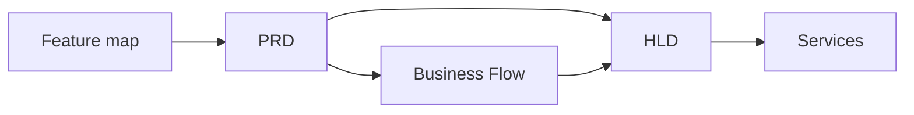

# Orbitalis documents

Start here. This page links to every product and design document in the repo. Updated 15 November 2026.

## Read in this order

| #   | Document                          | What it answers                                                                     | Read it when                                            |
| --- | --------------------------------- | ----------------------------------------------------------------------------------- | ------------------------------------------------------- |
| 1   | [Feature map](feature-map.html)   | What pages, map layers, and journeys the product has, in plain words                | You are new, or you explain the product to someone else |
| 2   | [PRD](prd-orbitalis.md)           | What we build and why: users, the six needs, features F1–F21, KPIs, roadmap, risks  | You decide scope or write a feature                     |
| 3   | [Business Flow](business-flow.md) | Who does what, in what order, for each need                                         | You design a user flow or talk to an agency             |
| 4   | [HLD](hld-orbitalis.md)           | How the system is built: parts, data flow, projection, scores, map layers, database | You plan a technical change                             |
| 5   | [Services](services.md)           | What runs in `apps/`: `web`, `jobs`, `notifier`, and each job script                | You add or change a service or a job                    |
| 6   | [Submission](submission.md)       | The Space Apps 2026 project page text, checklist, NASA data, and references         | You fill in or review the hackathon submission          |

The feature map is an HTML file. Open it in a browser. The other documents are Markdown with Mermaid diagrams.

## Design and build rules

| Document                                    | What it holds                                                                                     |
| ------------------------------------------- | ------------------------------------------------------------------------------------------------- |
| [design.md](../design.md)                   | Design tokens, type, motion, and component rules. Live showcase at `/design-system` in `apps/web` |
| [CLAUDE.md](../CLAUDE.md)                   | Engineering, process, repo, and design rules for everyone, people and agents                      |
| [apps/web/AGENTS.md](../apps/web/AGENTS.md) | Rules for the Next.js app                                                                         |
| [README.md](../README.md)                   | Setup, scripts, and deploy                                                                        |

## Plans and older documents

| Document                                                 | State                                                                                                                    |
| -------------------------------------------------------- | ------------------------------------------------------------------------------------------------------------------------ |
| [Plans index](../plans/README.md)                        | Animation plans 001–004, all done                                                                                        |
| [Goal: dashboard prototype](goal-dashboard-prototype.md) | 7 November 2026. The map-first goal for the hackathon prototype. The PRD replaces it for the product after the hackathon |

## How the documents connect

- The **PRD** is the source of truth for scope. If another document disagrees with it, fix the other document.
- The **HLD** and **Services** follow the PRD feature numbers (F1–F21, G1).
- The **feature map** is a visual summary. When a page, layer, or journey changes in the PRD, update the feature map in the same commit.

## Sources used across the documents

- NASA Space Apps 2026, [Dancing with the SARs](https://www.spaceappschallenge.org/2026/challenges/dancing-with-the-sars)
- KemenLH, [water farming rule draft](https://www.kemenlh.go.id/news/detail/atasi-tanah-ambles-menteri-lh-siapkan-aturan-tentang-water-farming), 2 June 2026
- CNBC Indonesia, [groundwater permit rule](https://www.cnbcindonesia.com/news/20231113152455-4-488628/ngebor-air-tanah-wajib-izin-pemerintah-blak-blakan) (Kepmen ESDM 291.K/GL.01/MEM.G/2023), 13 November 2023
- Handika, Widodo, Pravitasari, [PS-InSAR and MICMAC for Jakarta](https://ejournal.brin.go.id/JTL/article/view/1125/2515), Jurnal Teknologi Lingkungan 25(1), 2024
- Fielding, [ARSET InSAR notebooks](https://github.com/EJFielding/ARSET_notebooks)
- Katadata, [piped water coverage 82%](https://katadata.co.id/berita/nasional/6a60436dec29e/air-perpipaan-tembus-82-persen-pemprov-dki-kurangi-penggunaan-air-tanah) (coverage in May 2026), 22 July 2026
