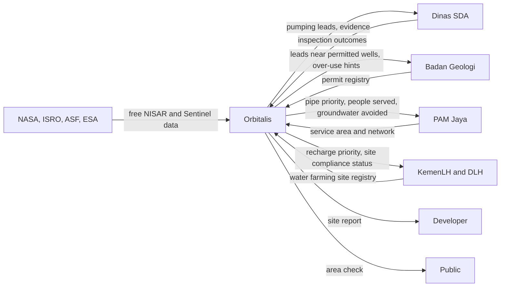
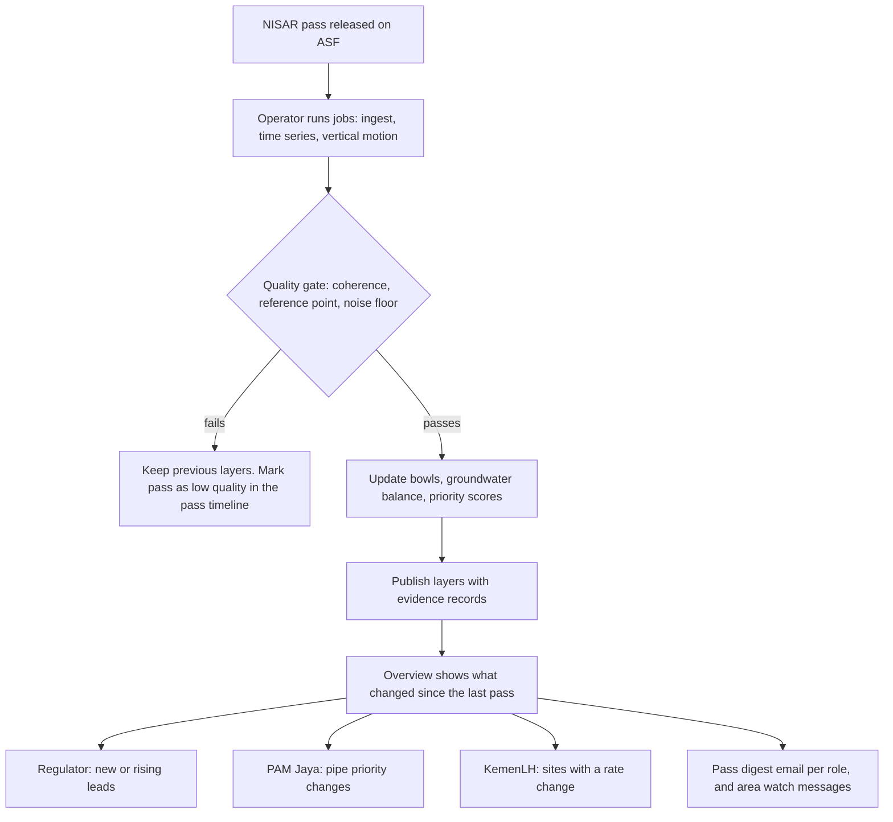
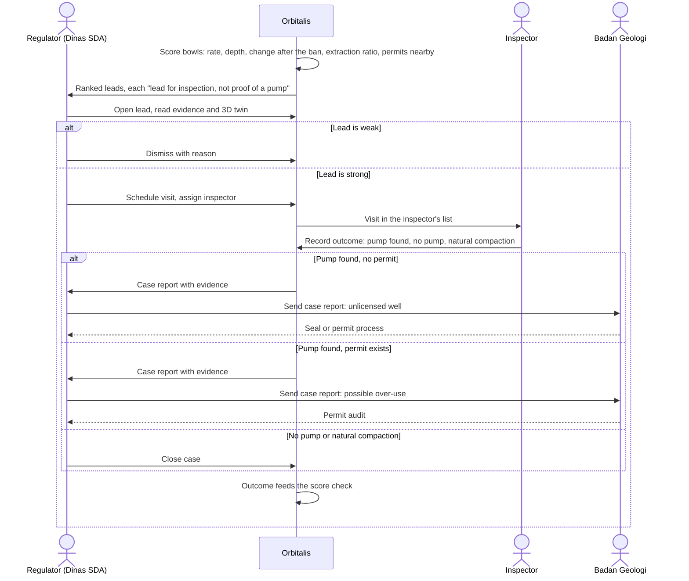
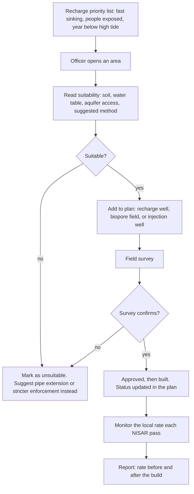
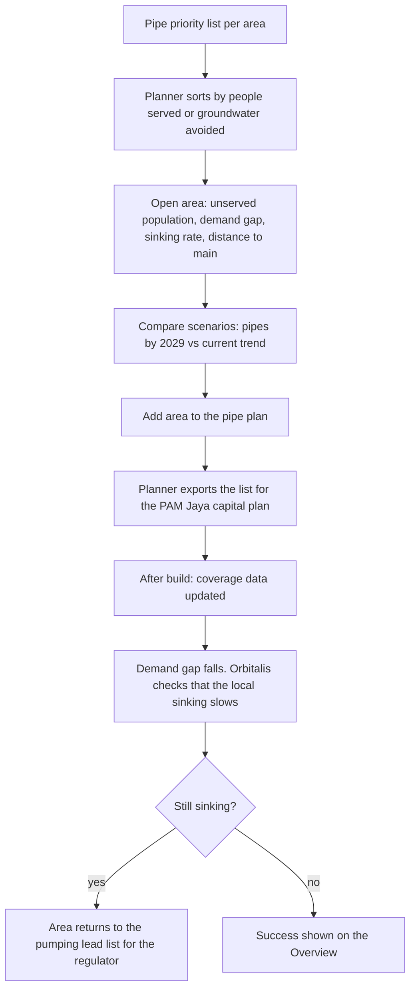
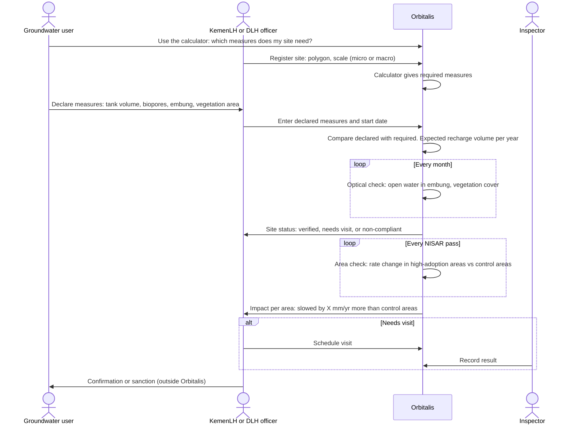
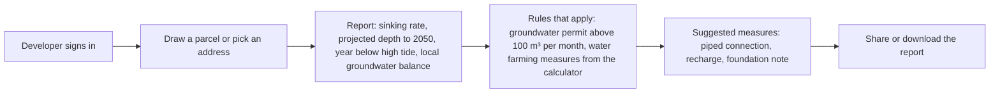
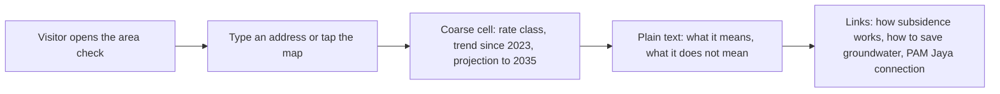

# Business Flow: Orbitalis

Status: Draft. Date: 15 November 2026. Scope: the product after the NASA Space Apps hackathon. Source documents: [PRD](prd-orbitalis.md) and [HLD](hld-orbitalis.md).

This document shows who does what, in what order, and what each step gives to the next. The HLD tells how the system is built. The PRD tells what each feature must do.

## 0. Flows in the app today

Each need has one path through the app. Sections 4 to 9 show the full target flows.

| Need | User | Path in the app | Ends with |
| --- | --- | --- | --- |
| N1 Illegal pump hints | Dinas SDA, Badan Geologi | Map, **Pump leads** layer, triage list (sort by signal, rate, people), bowl panel or bowl page | Schedule visit, then outcome: pump found, no pump, natural compaction |
| N2 Fast sinking, needs injection | KemenLH, Dinas SDA | Map, **Recharge** layer, ranked cells (sinking × people), cell panel | Recharge plan: proposed, surveyed, approved, built. CSV export |
| N3 Pipe extension with people count | PAM Jaya | Map, **Pipes** layer, ranked cells (people without pipes), cell panel | Pipe plan with the same steps. CSV export |
| N4 Water farming monitoring | KemenLH, DLH | Map, **Water farming** layer (58 public water bodies), red sites need a visit. Or Bowls desk, type "Water farming sites" | Schedule visit, then outcome: measures working, measures failing |
| N5 Developer planning | Developers | Map, any cell, **Site report** | Printable report: rate, depth by 2035 and 2050, people, nearest lead and water body, rules |
| N6 Buy or sell a house | Public | Landing, **Check an area** (`/check`, no sign-in), tap the map or use my location | Plain class (slow, medium, fast), cm per year, what it means and does not mean |

The **Start** page (`/start`, in the sidebar) shows these six needs as cards. A card opens the map on the right layer, or the area check. On the map, a click on a pump lead opens its 3D bowl page.

The Overview shows the open pump leads, the triage list, water farming site status, and the progress of both plans.

## 1. Actors

| Actor                 | Organization                              | Role in the flow                                                                                                                       |
| --------------------- | ----------------------------------------- | -------------------------------------------------------------------------------------------------------------------------------------- |
| Orbitalis operator    | Orbitalis team                            | Runs the processing jobs every NISAR pass. Publishes layers. Answers data questions.                                                   |
| Groundwater regulator | Pemprov DKI, Dinas Sumber Daya Air        | Acts on pumping leads. Enforces Pergub 93/2021 zones.                                                                                  |
| Permit authority      | Badan Geologi (ESDM)                      | Owns the groundwater permit registry (Kepmen ESDM 291.K/GL.01/MEM.G/2023: a permit above 100 m³ per month). Revokes or audits permits. |
| Inspector             | Dinas SDA or Badan Geologi                | Visits sites. Records what they found.                                                                                                 |
| Water utility planner | PAM Jaya                                  | Plans pipe extension to reach 100% coverage by 2029.                                                                                   |
| Environment officer   | KemenLH and regional DLH                  | Owns the water farming rule. Registers sites, checks compliance, gives sanctions. Plans recharge with Dinas SDA.                       |
| Groundwater user      | Households, offices, industry, businesses | Holds a permit. Does water farming measures. Declares them.                                                                            |
| Developer             | Real-estate company                       | Asks for a site report before land purchase or design.                                                                                 |
| Home buyer or seller  | The public                                | Checks an area before a deal.                                                                                                          |

## 2. Value exchange

Agency data comes back into Orbitalis and makes the next scores better. Inspection outcomes are the most important feedback: each "pump found" or "no pump" result tests the lead score.

## 3. Core cycle: one NISAR pass

NISAR passes over Jakarta every 12 days. Every product in Orbitalis refreshes on this cycle.

Exit of the cycle: the Overview lists rank up, rank down, new bowls, slowing bowls, and sites that changed. The same list goes out as one digest email per role (F20), so users do not need to open the app to know they must act. Each user starts their flow from there, on the map layer for their role.

## 4. Flow N1: from pumping hint to enforcement

Rules:

- A lead never names a person or a company. The inspector finds the facts on site.
- A bowl with no inspection record is a lead.
- A closed case stays visible in the bowl history. If the bowl keeps sinking after a "no pump" result, it comes back as a lead at the next pass with a note.

## 5. Flow N2: recharge and injection planning

Owners: KemenLH or DLH plan recharge, Dinas SDA builds public injection wells. The priority list is a screening tool. Only a field survey approves a site.

## 6. Flow N3: pipe extension planning

The handover between N3 and N1 matters: if an area has pipes but still sinks, people still pump. That is a strong pumping hint.

## 7. Flow N4: water farming monitoring

Site status and impact are separate. Site status says whether one user does the measures. Impact says whether the policy slows the sinking, and only area groups can show it. Success means the sinking slows, not that the ground rises.

The rule is a draft in November 2026. The flow uses the press release terms. Update this flow when KemenLH publishes the final regulation.

## 8. Flow N5: developer site report

The report is a screening document. It is not a geotechnical survey and not a legal opinion. Each report carries the data dates and the label "at current assumptions".

## 9. Flow N6: public area check

The area check shows cells, not buildings. It never says "do not buy". It gives facts and limits.

## 10. Hand-offs between flows

| From              | To              | Trigger                                                            |
| ----------------- | --------------- | ------------------------------------------------------------------ |
| N3 pipe built     | N1 pumping lead | Area has pipes, but sinking does not slow                          |
| N1 "no pump"      | N2 recharge     | Natural compaction or old pumping. Recharge may help               |
| N4 non-compliant  | N1 pumping lead | Site extracts but does not recharge                                |
| N2 recharge built | N4 monitor      | A public recharge site uses the same monitoring checks             |
| Any desk          | Core cycle      | New agency data (permits, coverage, sites) enters at the next pass |

## 11. Business rules

1. A lead is a reason to inspect. It is never proof. All UI and exports say so.
2. Projections use stated assumptions and say "at current assumptions".
3. No personal names in leads, the public area check, or the repo.
4. Agency data stays inside the agency roles that own it.
5. Satellite checks support field checks. They never close a case alone.
6. Each number links to its source, dates, and method.

## 12. Open business decisions

1. Operating model: one agency hosts Orbitalis (for example KemenLH as the national owner), or each agency subscribes.
2. Price for developer reports: free during a pilot, then paid, or always free.
3. Data agreements with Badan Geologi (permits) and PAM Jaya (network). Who signs, and what each side gets.
4. Who receives non-compliance results from N4: KemenLH centrally, or each DLH.
5. Whether the public area check launches before the agency desks, or after a pilot.
