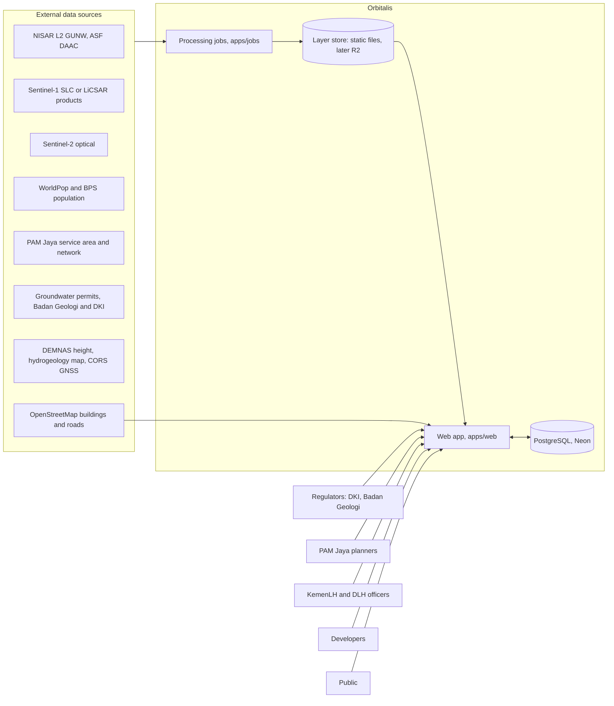
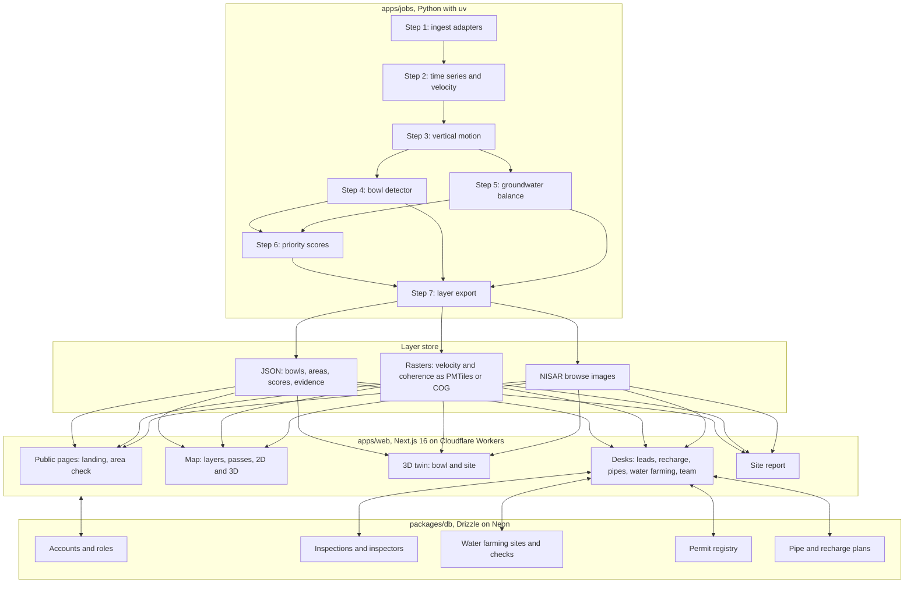
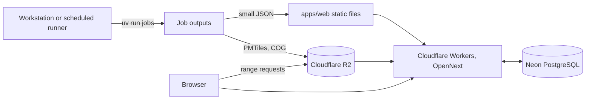

# HLD: Orbitalis

Status: Draft. Date: 15 November 2026. Scope: the product after the NASA Space Apps hackathon. Source documents: [PRD](prd-orbitalis.md) and [Business Flow](business-flow.md).

This document describes the high-level design. It tells what parts the system has, what each part owns, how data moves between them, and which parts exist on `main` today. It does not give code-level design.

## 1. Purpose

Orbitalis turns radar measurements of ground motion into decisions about groundwater. It serves six needs:

| #   | Need                                                                               | Main user                                      | Feature group         |
| --- | ---------------------------------------------------------------------------------- | ---------------------------------------------- | --------------------- |
| N1  | Find hints of illegal groundwater pumps                                            | Pemprov DKI (Dinas SDA), Badan Geologi (ESDM)  | Pumping leads         |
| N2  | Find fast-sinking areas that need groundwater recharge or injection                | KemenLH, Dinas SDA                             | Recharge priority     |
| N3  | Recommend where to extend water pipes, with an estimate of the people in each area | PAM Jaya                                       | Pipe priority         |
| N4  | Monitor water farming compliance                                                   | KemenLH and regional environment offices (DLH) | Water farming monitor |
| N5  | Plan building projects (secondary)                                                 | Real-estate developers                         | Site report           |
| N6  | Check an area before buying or selling a house (tertiary)                          | The public                                     | Area check            |

Three shared capabilities carry all six needs: **Maps**, **3D visualization**, and the **groundwater use projection**. Section 4 shows how each need uses them.

## 2. System context



Rules at the boundary:

- The web app never downloads satellite files during a page request. Jobs do all heavy work in batch.
- Permit data and pipe network data come from agencies. Until a data agreement exists, the system uses synthetic copies (the repo holds no real data, see `CLAUDE.md`).
- Every output carries an evidence record: source, product, version, dates, method, units, and quality threshold.

## 3. Building blocks



### 3.1 Processing jobs (`apps/jobs`)

Each job is a Python script. Each job is idempotent: the same input gives the same output and no duplicates. Each job writes an evidence record next to its output.

| Step | Job                      | Input                                                                    | Output                                                                                    | Method reference                                                                                                                                                                                     | State                                                                       |
| ---- | ------------------------ | ------------------------------------------------------------------------ | ----------------------------------------------------------------------------------------- | ---------------------------------------------------------------------------------------------------------------------------------------------------------------------------------------------------- | --------------------------------------------------------------------------- |
| 1    | Ingest adapters          | NISAR GUNW HDF5, Sentinel-1 product, DEMNAS, population grid, permit CSV | Checked rasters and tables on one grid (EPSG:32748, 30 m for radar, 100 m for population) | NISAR Data User Guide                                                                                                                                                                                | NISAR browse images only (`fetch_nisar_browse.py`)                          |
| 2    | Time series and velocity | Stack of GUNW pairs per track                                            | Displacement time series, velocity, temporal coherence                                    | MintPy `smallbaselineApp.py` on the GUNW stack, as in the ARSET 2023 Central Valley notebook (load, network, connected-component mask, inversion, troposphere correction, reference point, velocity) | Not built                                                                   |
| 2b   | Long-term C-band rate    | Sentinel-1 2015–2023                                                     | Velocity before the ban                                                                   | PS-InSAR thresholds from Handika et al. 2024: at least 20 images, amplitude stability index 0.8 or more, temporal coherence 0.9 or more. Or SBAS with LiCSBAS                                        | Synthetic series in `bowls-seed.json`                                       |
| 3    | Vertical motion          | Ascending track 10, descending track 18                                  | Vertical and east-west velocity                                                           | Two-geometry decomposition with stored incidence and heading angles                                                                                                                                  | Not built                                                                   |
| 4    | Bowl detector            | Vertical velocity                                                        | Bowls: center, radius, peak rate, depth, noise floor                                      | Local minimum after regional trend removal, signal-to-noise test                                                                                                                                     | Started: `detect_bowls.py` works on one pair (uncommitted). Needs the stack |
| 5    | Groundwater balance      | Vertical velocity, population, piped coverage, permits                   | Two extraction estimates per area and their ratio. Projection to 2050                     | Section 5                                                                                                                                                                                            | Not built                                                                   |
| 6    | Priority scores          | Bowls, balance, permits, buildings, high tide                            | Pumping lead score, recharge priority, pipe priority                                      | Section 6                                                                                                                                                                                            | Not built (rank is a seed value)                                            |
| 7    | Layer export             | All outputs                                                              | JSON and tile files in the layer store                                                    |                                                                                                                                                                                                      | Partial (browse images and pair catalog)                                    |

OPERA DISP-S1 covers North America only. It is not available for Jakarta. The design takes two ideas from the ARSET 2026 DISP notebook: the ministack chain (the last date of one stack is the reference of the next) and the quality layers (recommended mask, temporal coherence, connected components). Our NISAR chain uses both.

### 3.2 Layer store

| Phase                        | Store                                                                                     | Why                                                                                                                                                     |
| ---------------------------- | ----------------------------------------------------------------------------------------- | ------------------------------------------------------------------------------------------------------------------------------------------------------- |
| Now                          | Static files in `apps/web` (`bowls-seed.json`, `nisar-pairs.json`, `public/nisar/*.webp`) | Small. Deploys with the app.                                                                                                                            |
| When a raster layer is added | Cloudflare R2 bucket with PMTiles (raster and vector) and one JSON index                  | Velocity grids are too large for Worker static assets (25 MiB per file limit). MapLibre reads PMTiles with range requests, so no tile server is needed. |

Aggregated values (per bowl, per kelurahan, per 100 m cell for the area check) stay as JSON. Only full-resolution rasters go to R2.

### 3.3 Web app (`apps/web`)

Next.js 16 App Router, React Server Components, deployed to Cloudflare Workers with OpenNext. It follows `.agents/skills/nextjs-app-architecture`. Features live in `src/features/<name>`.

| Area                              | Route (under `/[locale]`)                   | Access              | Built on `main`                               |
| --------------------------------- | ------------------------------------------- | ------------------- | --------------------------------------------- |
| Landing                           | `/landing`                                  | Public              | Yes                                           |
| Area check (N6)                   | `/check`                                    | Public, coarse data | No                                            |
| Map                               | `/map`                                      | Sign-in             | Yes (bowls, NISAR passes, 3D buildings)       |
| Bowl twin                         | `/bowls/[id]`                               | Sign-in             | Yes                                           |
| Overview                          | `/` desk home                               | Sign-in             | Yes                                           |
| Pumping leads (N1)                | `/bowls` desk                               | Regulator           | Yes as inspection table. Lead score not built |
| Recharge priority (N2)            | `/recharge`                                 | Regulator, KemenLH  | No                                            |
| Pipe priority (N3)                | `/pipes`                                    | PAM Jaya            | No                                            |
| Water farming (N4)                | `/water-farming`, `/water-farming/[siteId]` | KemenLH, DLH        | No                                            |
| Site report (N5)                  | `/report`                                   | Developer account   | No                                            |
| Team                              | `/team`                                     | Regulator           | Yes                                           |
| Case report (N1)                  | `/bowls/[id]/report`                        | Agency roles        | No                                            |
| Water farming calculator (N4, N5) | `/water-farming/calculator`                 | Public              | No                                            |

Pass digest (F20): after the publish step, one job reads what changed per role and sends one email per user through a transactional email service. It runs outside the Worker, next to the processing jobs. The digest reads the same change list as the Overview, so the two never disagree.

Shared map and 3D parts:

- **Map** (MapLibre, mapcn): one map component with switchable layers: bowls, velocity raster, NISAR passes, lead score, recharge priority, pipe priority, water farming sites, population. Each desk opens the map with its own default layers.
- **3D twin**: today it shows one bowl. The same scene shows a water farming site or a developer parcel: soil layers, buildings, high tide, and the year timeline.
- **Projection panel**: one component that shows the two extraction estimates, their ratio, and the scenario timeline. Used on the bowl page, the area page, the site report, and the area check.

### 3.4 Database (`packages/db`)

PostgreSQL on Neon through Drizzle. It holds only things people create or decide. Radar outputs stay in the layer store.

| Table                                        | Exists | Purpose                                                                                                                                                            |
| -------------------------------------------- | ------ | ------------------------------------------------------------------------------------------------------------------------------------------------------------------ |
| `user`, `session`, `account`, `verification` | Yes    | Better Auth                                                                                                                                                        |
| `inspection`                                 | Yes    | Visit status and outcome per bowl                                                                                                                                  |
| `inspector`                                  | Yes    | Inspector roster                                                                                                                                                   |
| `organization`, `member`                     | No     | Agency and role: `dki_regulator`, `badan_geologi`, `pam_jaya`, `kemenlh`, `dlh`, `developer`. Better Auth organization plugin                                      |
| `well_permit`                                | No     | Permit number, holder type (no personal names in the repo), location, permitted volume m³/month, valid dates. Source: Badan Geologi and DKI registries             |
| `water_farming_site`                         | No     | Site polygon, extractor type (micro: housing or office, macro: industry or business), required measures, declared measures                                         |
| `water_farming_check`                        | No     | Check date, method (field visit, satellite, optical), result, note, user                                                                                           |
| `plan_item`                                  | No     | A recharge site or a pipe segment that a user adopts from a priority list: type, area id, status (proposed, approved, built), user                                 |
| `area_watch`                                 | No     | User, area id or cell, digest on or off. Feeds the pass digest and the area watch (F20)                                                                            |
| `water_farming_factor`                       | No     | Calculator factors (rainfall, runoff share, infiltration per measure), each with a source and a valid date (F21). Data, not code, so a rule change needs no deploy |

All new tables store the user and the time of each change, as `inspection` does today.

## 4. Needs mapped to capabilities

| Need                 | Maps                                         | 3D visualization                                | Groundwater use projection                                                              | Extra data                        |
| -------------------- | -------------------------------------------- | ----------------------------------------------- | --------------------------------------------------------------------------------------- | --------------------------------- |
| N1 Pumping leads     | Bowls and lead score layer                   | Bowl twin with soil layers and illustrated well | Ratio of subsidence-based extraction to demand gap. A high ratio adds to the lead score | Permit registry                   |
| N2 Recharge priority | Recharge priority layer                      | Twin shows clay layer and high tide             | Projected depth with and without recharge                                               | Hydrogeology map, DEMNAS          |
| N3 Pipe priority     | Unserved population and pipe priority layers | Not needed                                      | Demand gap per area, and the drop if pipes arrive                                       | Population, PAM Jaya service area |
| N4 Water farming     | Site polygons with status color              | Site twin                                       | Expected recharge volume from declared measures                                         | Site registry, Sentinel-2         |
| N5 Site report       | Parcel and its surroundings                  | Parcel twin                                     | Projected depth to 2050, local groundwater balance                                      | Permit rule summary               |
| N6 Area check        | Coarse rate cells                            | Not needed                                      | Simple "sinking now, projected by 2035" text                                            | None                              |

## 5. Groundwater use projection

The projection gives two independent estimates of groundwater extraction for each area (kelurahan, or a 500 m cell), then compares them.

**Estimate A: demand gap (from people).**

```
A = population × use per person × (1 − piped coverage) − permitted surface supply
```

- Population: WorldPop 100 m grid scaled to BPS kelurahan totals.
- Use per person: default 250 L per day (30 m³ per month for a household of four, from Badan Geologi, CNBC Indonesia 13 Nov 2023). A setting, with evidence.
- Piped coverage: PAM Jaya service area by kelurahan. City value 82% in May 2026 (Katadata, July 2026). Target 100% by 2029 (RPJMD 2025–2029).
- Non-domestic users (industry, hotels, malls) enter through the permit registry, by permitted volume.

**Estimate B: extraction from subsidence (from the ground).**

```
B = compaction volume rate × k
compaction volume rate = Σ (vertical rate × cell area) over the area
```

- Vertical rate from step 3, with the natural compaction part removed. Natural compaction is estimated from areas with no pumping and the same soil (Handika et al. 2024 rank natural alluvial compaction second after pumping).
- `k` converts compacted volume to pumped volume. It is calibrated in areas with good permit and meter data. Until calibration, B is shown only as a relative index, not in m³.

**Cross-check.**

| Result                          | Meaning                                                                      | Use                                    |
| ------------------------------- | ---------------------------------------------------------------------------- | -------------------------------------- |
| B ≫ A (ratio above a set limit) | The ground loses more water than the known users explain                     | Adds to the pumping lead score (N1)    |
| B ≈ A                           | Known use explains the sinking                                               | Pipe extension (N3) is the main remedy |
| B ≪ A                           | Demand is met from other sources, or the aquifer is not the clay-bearing one | Check data. No action                  |

**Scenarios to 2050.** Current trend. Pipes reach 100% by 2029. Pumping ban fully enforced. Water farming adopted at a set rate. Each scenario changes A, and through `k` changes the projected rate and depth. The twin and the year timeline show the result. A projection is "at current assumptions", not a forecast.

## 6. Priority scores

All scores are fixed formulas with visible weights. No machine learning model. Each score opens its inputs and weights in the evidence panel.

| Score                  | Inputs                                                                                                                                                                                                       | Output                                                                                                                          |
| ---------------------- | ------------------------------------------------------------------------------------------------------------------------------------------------------------------------------------------------------------ | ------------------------------------------------------------------------------------------------------------------------------- |
| Pumping lead (N1)      | Bowl peak rate and depth, change after the 2023 ban, B/A ratio, no permitted well within the bowl radius, permitted volume exceeded                                                                          | Ranked bowls. Label: "lead for inspection, not proof of a pump"                                                                 |
| Recharge priority (N2) | Vertical rate, people and buildings exposed, year below high tide, recharge suitability (shallow soil permeability and depth to water table for recharge wells; confined aquifer access for injection wells) | Ranked areas with a suggested method: recharge well, biopore field, or injection well. Label: "screening, needs a field survey" |
| Pipe priority (N3)     | Unserved population, demand gap A, vertical rate, distance to the existing main                                                                                                                              | Ranked areas with people served and groundwater avoided per year                                                                |

Handika et al. 2024 (MICMAC) rank the drivers of Jakarta subsidence: groundwater over-extraction and natural alluvial compaction are the key drivers; building load, population density, and industrial activity are relay drivers; land use is a dependent factor; tectonics has little effect. The scores follow this order: pumping inputs carry the most weight, building and population inputs act as exposure, tectonics is left out.

## 7. Water farming monitoring

The KemenLH rule (press release SR.107/HUMAS/KLH-BPLH/6/2026, 2 June 2026) is a draft. It requires each groundwater user to have a permit and to return water to the ground. Micro scale (housing and offices): rainwater harvest, runoff capture, biopores. Macro scale (industry and business): an embung or artificial lake near the site, or vegetation over a set area.

The monitor checks each registered site in three ways:

1. **Declared measures** from the site registry (tank volume, biopore count, embung area, vegetation area). The system turns them into an expected recharge volume per year.
2. **Optical check** with Sentinel-2: an embung shows open water (NDWI), required vegetation shows green cover (NDVI). Run each month.
3. **Ground check** with NISAR: the vertical rate in the site and a ring around it, before and after the declared start date. A site that recharges should slow its local sinking over time. This check is slow (months to years) and noisy, so it supports the other two and never decides alone.

Status per site: registered, measures declared, verified, needs visit, non-compliant. A field visit uses the same visit flow as inspections (F9).

The water farming calculator (F21) gives the required measures for a site from its area, roof area, sealed area, groundwater use, and scale. The monitor compares declared with required. A site below required goes to "needs visit". The same calculator runs in the developer site report (F16).

## 8. Deployment



- Jobs run on a workstation now. They move to a scheduled runner when NISAR passes are processed every 12 days.
- Earthdata credentials stay in `~/.netrc` or runner secrets. Never in the repo, never in the browser.
- The Worker stays small: the bowl pages already hit Worker limits (commit `6f78a99`). Large data goes to R2, not into the Worker bundle.

## 9. Security and privacy

- Roles decide what each user sees. Permit holders and water farming sites are visible only to the agency roles that own them.
- The public area check shows coarse cells (no single building), rate classes, and projections with their limits. It names no owner and no building.
- Pumping leads never name people or companies. A lead is an area.
- All demo data is synthetic. Permit and site seeds use synthetic holders.

## 10. Quality attributes

| Attribute     | Target                                                                                                                                                                                 |
| ------------- | -------------------------------------------------------------------------------------------------------------------------------------------------------------------------------------- |
| Traceability  | 100% of numbers open an evidence record                                                                                                                                                |
| Freshness     | New NISAR pass processed within 3 days of its ASF release                                                                                                                              |
| Accuracy      | Radar vertical rate agrees with CORS GNSS within the stated uncertainty. Mean Jakarta rate in the range of published PS-InSAR results (−5.71 cm/yr for 2021–2022, Handika et al. 2024) |
| Performance   | Map first view in 3 s or less on a desktop connection. Worker bundle under the Cloudflare limit                                                                                        |
| Accessibility | Keyboard and screen reader for all desk tasks. Every map layer has a table view                                                                                                        |
| Language      | English and Indonesian for every string                                                                                                                                                |

## 11. Open design decisions

1. Grid for the projection and priority scores: kelurahan or 500 m cells.
2. Calibration area and data for `k` in estimate B.
3. Access to the permit registry (Badan Geologi, DKI) and the PAM Jaya network. Until then, synthetic seeds.
4. When to move from static files to R2.
5. Sentinel-1 path: own PS-InSAR or SBAS run, or a published LiCSAR product.
6. Which hydrogeology map sets recharge suitability.
7. Whether the public area check needs a sign-in to limit scraping.

## References

- KemenLH, "Atasi tanah ambles, Menteri LH siapkan aturan tentang water farming", 2 June 2026. <https://www.kemenlh.go.id/news/detail/atasi-tanah-ambles-menteri-lh-siapkan-aturan-tentang-water-farming>
- CNBC Indonesia, "Ngebor air tanah wajib izin pemerintah", 13 November 2023 (Kepmen ESDM 291.K/GL.01/MEM.G/2023). <https://www.cnbcindonesia.com/news/20231113152455-4-488628/ngebor-air-tanah-wajib-izin-pemerintah-blak-blakan>
- NASA Space Apps 2026, "Dancing with the SARs". <https://www.spaceappschallenge.org/2026/challenges/dancing-with-the-sars>
- Handika, Widodo, Pravitasari, "Combined Land Subsidence Analysis in Jakarta Based on PS-InSAR and MICMAC Methods", Jurnal Teknologi Lingkungan 25(1), 2024. <https://ejournal.brin.go.id/JTL/article/view/1125/2515>
- Fielding, ARSET InSAR notebooks (ARIA GUNW with MintPy, OPERA CSLC, OPERA DISP). <https://github.com/EJFielding/ARSET_notebooks>
- Katadata, piped water coverage 82% (May 2026). <https://katadata.co.id/berita/nasional/6a60436dec29e/air-perpipaan-tembus-82-persen-pemprov-dki-kurangi-penggunaan-air-tanah>
