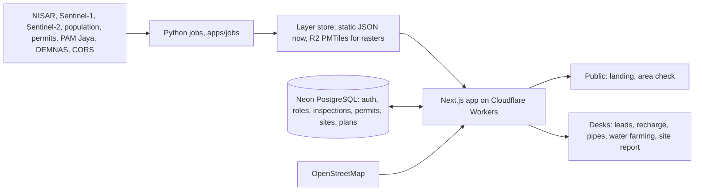

# PRD: Orbitalis — radar ground motion for groundwater decisions

Status: Draft. Updated 15 November 2026. This version moves the scope from the hackathon prototype to the product after the hackathon. It adds six user needs (section 1, "Needs and features"), new users (PAM Jaya, KemenLH, developers, the public), and the groundwater use projection. The repo name is `orbitalis`. The product name in the app is Orbitalis.

Related documents: [HLD](hld-orbitalis.md) (system design) and [Business Flow](business-flow.md) (who does what, in what order).

The prototype was built for the NASA Space Apps Challenge 2026 challenge [Dancing with the SARs](https://www.spaceappschallenge.org/2026/challenges/dancing-with-the-sars/) (14–15 November 2026). Section 0 keeps the challenge fit. Judges score Impact, Creativity, Validity, Relevance, and Presentation. [Judging guide](https://spaceappschallenge.org/resources/judging-awards-guide)

## 0. Challenge fit

### What the challenge asks

The challenge asks teams to "build an interactive application that leverages radar remote sensing data from NISAR to track and visualize one or more types of surface changes, at locations around the world". It names "land surfaces deforming from earthquakes and coastal subsidence" as one type of change. The desired outcome is "an open-source, user-friendly solution that translates complex radar observations into actionable insights" for "scientists, resource managers, educators, decision-makers, and the public".

The challenge gives three steps:

1. Pick a study area. A hometown is a good choice.
2. Download free NISAR data from the resource list. Supplemental data (optical images, GIS layers) is permitted.
3. Present the findings in an interactive digital medium (report, video, slides, story map). "Hypothesize the physical drivers behind what you see (or don't see) in the SAR data." Say "what future applications of NISAR are possible".

Optional considerations: other polarizations or other frequencies from other sensors, a time series from different dates, ancillary data (for example population), human drivers such as industry, data storytelling, personal context for a hometown, and interactive parts such as image sliders and web maps.

### How Orbitalis answers each item

| Challenge item             | Orbitalis answer                                                                                               | State on `main`                                                                      |
| -------------------------- | -------------------------------------------------------------------------------------------------------------- | ------------------------------------------------------------------------------------ |
| Interactive application    | Next.js web app: map, bowl page with a 3D digital twin, desk pages                                             | Built                                                                                |
| NISAR data                 | NISAR L2 GUNW browse images, track 10 ascending, 8 pairs from 26 June 2026. A bowl detector reads GUNW HDF5    | Browse images built. `apps/jobs/detect_bowls.py` reads one HDF5 pair (not committed) |
| Surface change type        | Coastal land subsidence in North Jakarta                                                                       | Built with synthetic bowl values                                                     |
| Change over time           | Year timeline 2015–2050, NISAR pass timeline, Sentinel-1 and NISAR chart                                       | Built with synthetic series                                                          |
| Other frequency            | Sentinel-1 (C-band) for the rate before the 2023 ban. SAOCOM (L-band, CONAE) is a possible second L-band check | Synthetic Sentinel-1 series. SAOCOM not started                                      |
| Ancillary data             | OpenStreetMap buildings, kecamatan names. Population and piped-water coverage planned (F12, F14)               | Buildings and names built                                                            |
| Human driver               | Deep groundwater pumping, the 2023 groundwater ban, permits, and piped-water gaps                              | Built as the main story                                                              |
| Physical driver hypothesis | Section 4, "Physical driver hypothesis"                                                                        | Written. Shown in the twin                                                           |
| Actionable insight         | Pumping leads, recharge priority, pipe priority, water farming status                                          | Pumping leads and the visit workflow built                                           |
| Open source                | Public repo                                                                                                    | Repo is ready to open                                                                |
| Hometown context           | Team members live in Indonesia                                                                                 | Partial                                                                              |
| Story and presentation     | Landing page, demo video, slides                                                                               | Landing page built                                                                   |
| Future NISAR applications  | Section 5, roadmap                                                                                             | Written                                                                              |

### Challenge resources (published 13 November 2026)

NASA does not endorse non-U.S. Government sites. Each site has its own data use terms.

| Resource                                                                                                                                                                                                                       | Provider              | Use in Orbitalis                                                             |
| ------------------------------------------------------------------------------------------------------------------------------------------------------------------------------------------------------------------------------ | --------------------- | ---------------------------------------------------------------------------- |
| [NASA Earthdata Search](https://search.earthdata.nasa.gov/search)                                                                                                                                                              | NASA                  | Find NISAR products. Earthdata login for HDF5 download                       |
| [ASF Data Search Vertex](https://search.asf.alaska.edu/)                                                                                                                                                                       | ASF DAAC              | NISAR GUNW search. `apps/jobs/fetch_nisar_browse.py` uses the ASF search API |
| [NISAR Data User Guide](https://nisar-docs.asf.alaska.edu/)                                                                                                                                                                    | ASF                   | Product formats, availability, GUNW layers                                   |
| [Intro to Remote Sensing](https://www.earthdata.nasa.gov/learn/earth-observation-data-basics/remote-sensing)                                                                                                                   | NASA Earthdata        | Background for the landing page and FAQ                                      |
| [Intro to SAR](https://www.earthdata.nasa.gov/learn/earth-observation-data-basics/sar)                                                                                                                                         | NASA Earthdata        | Wavelength and coherence text (F5)                                           |
| [NASA ARSET Trainings](https://appliedsciences.nasa.gov/get-involved/training)                                                                                                                                                 | NASA Applied Sciences | InSAR time-series method (see "Method references")                           |
| [NISAR StoryMaps](https://nisar.jpl.nasa.gov/applications/arcgis-storymaps/)                                                                                                                                                   | NASA JPL              | Reference for the storytelling                                               |
| [NISAR Applications White Papers](https://nisar.jpl.nasa.gov/applications/societal-benefit/)                                                                                                                                   | NASA JPL              | Cite the subsidence and groundwater application                              |
| [UAVSAR Postcards](https://uavsar.jpl.nasa.gov/education/postcards.html)                                                                                                                                                       | NASA JPL              | Not used                                                                     |
| [RCM data](https://donnees-data.asc-csa.gc.ca/en/dataset/rcm), [SAR Python tutorial](https://github.com/asc-csa/Synthetic_Aperture_Radar_Tutorial), [RADARSAT-1 data](https://donnees-data.asc-csa.gc.ca/en/dataset/radarsat1) | CSA                   | Not used                                                                     |
| [SAOCOM catalogue](https://catalogos.conae.gov.ar/catalogo/catalogoSatSaocomInfo.html), [registration](https://www.argentina.gob.ar/noticias/la-informacion-saocom-cada-vez-mas-accesible)                                     | CONAE                 | Optional L-band check. Needs registration                                    |

Sentinel-1, Sentinel-2, DEMNAS, WorldPop, and Ina-CORS are not in the resource list. The challenge permits supplemental data.

## 1. Executive Summary

### Problem Statement

Cities on the north coast of Java sink by several centimeters each year. In North Jakarta, some areas sink more than 10 cm a year. PS-InSAR on Sentinel-1 gives a mean rate of −5.71 cm/yr for Jakarta in 2021–2022, with the fastest sinking in North and West Jakarta (Handika et al. 2024). Groundwater over-extraction and natural compaction of alluvial soil are the two key drivers.

Four government groups act on this problem, and each one lacks a city-wide view:

- **Pemprov DKI and Badan Geologi** control pumping. Jakarta banned groundwater use in large zones (Pergub 93/2021, stronger from August 2023). A national permit is required above 100 m³ per month (Kepmen ESDM 291.K/GL.01/MEM.G/2023). They do not know where unlicensed or excess pumping still happens.
- **PAM Jaya** must reach 100% piped coverage by 2029 (RPJMD 2025–2029). Coverage was 82% in May 2026. They do not rank the remaining areas by how much groundwater a pipe would replace.
- **KemenLH** is preparing a rule that every groundwater user must have a permit and return water to the ground ("water farming", press release 2 June 2026). They have no way to check thousands of sites.
- **KemenLH and Dinas SDA** want to recharge or inject water where the ground sinks fastest. They have no ranked list of suitable areas.

Two groups outside government also need the same facts: developers who plan buildings, and people who buy or sell a house.

### Proposed Solution

One platform that turns NISAR and Sentinel-1 radar motion into groundwater decisions. Three shared capabilities carry it:

1. **Maps**: a 3D map with switchable layers (bowls, velocity, NISAR passes, priority scores, sites, population).
2. **3D visualization**: a digital twin of the ground under a bowl, a site, or a parcel, with soil layers, buildings, high tide, and a year timeline.
3. **Groundwater use projection**: two independent estimates of groundwater extraction per area (from people and from ground motion), their ratio, and scenarios to 2050.

On top of these, each user group has a desk: pumping leads with an inspection workflow (built), recharge priority, pipe priority, water farming monitoring, a developer site report, and a public area check.

### Needs and features

The team mapped six needs to the capabilities. N1–N4 are primary. N5 is secondary. N6 is tertiary.

| #   | Need (original wording)                                                                                                                            | User                     | Maps | 3D  | Projection             | Feature          | State     |
| --- | -------------------------------------------------------------------------------------------------------------------------------------------------- | ------------------------ | ---- | --- | ---------------------- | ---------------- | --------- |
| N1  | Find hints of illegal pumps (_deteksi petunjuk pompa ilegal_)                                                                                      | Dinas SDA, Badan Geologi | Yes  | Yes | Extraction ratio       | F3, F9, F12, F19 | Partial   |
| N2  | Areas that sink fast and need groundwater injection (_daerah yang laju penurunan tanahnya cepat dan perlu injeksi air tanah_)                      | KemenLH, Dinas SDA       | Yes  | Yes | Scenario with recharge | F13              | Not built |
| N3  | Recommend water pipe extension, with the number of people in each area (_rekomendasi pembangunan pipa air, estimasi ada berapa orang di area itu_) | PAM Jaya                 | Yes  | No  | Demand gap             | F14              | Not built |
| N4  | Monitor water farming (KemenLH)                                                                                                                    | KemenLH, DLH             | Yes  | Yes | Expected recharge      | F15, F21         | Not built |
| N5  | Building plans for real-estate developers (secondary)                                                                                              | Developers               | Yes  | Yes | Local balance          | F16, F21         | Not built |
| N6  | People who want to buy or sell a house (tertiary)                                                                                                  | Public                   | Yes  | No  | Simple text            | F17, F20         | Not built |

The three capabilities alone leave gaps in the flows. F12–F18 fill the main gaps. F19–F21 fill three more that the [Business Flow](business-flow.md) shows:

| Gap                                                                                                                                                                                     | Where it shows                 | New feature                    |
| --------------------------------------------------------------------------------------------------------------------------------------------------------------------------------------- | ------------------------------ | ------------------------------ |
| A regulator must hand evidence to Badan Geologi after "pump found", but no feature makes that document                                                                                  | Business Flow section 4        | F19 Case report                |
| Agencies act every 12 days, but they must open the app to see what changed                                                                                                              | Business Flow section 3        | F20 Pass digest and area watch |
| The water farming rule says measures must be "proportional", but no one can tell a user or a developer what that means for one site, and officers cannot compare declared with required | Business Flow sections 7 and 8 | F21 Water farming calculator   |

| Capability                 | State on `main`                                                                                                      |
| -------------------------- | -------------------------------------------------------------------------------------------------------------------- |
| Maps                       | Built: globe flight, bowl stacks, NISAR passes, 3D buildings. Missing: velocity raster, priority layers, site layers |
| 3D visualization           | Built for bowls. Missing: site and parcel twins                                                                      |
| Groundwater use projection | Not built. Today the app projects ground depth and the "below high tide" year only (F4)                              |

### Confirmed scope

| Item                | Decision                                                                                                                                                                                     |
| ------------------- | -------------------------------------------------------------------------------------------------------------------------------------------------------------------------------------------- |
| Primary users       | Government, split by role, all equal: Dinas SDA and Badan Geologi (N1), PAM Jaya (N3), KemenLH and DLH (N2, N4).                                                                             |
| Secondary user      | Real-estate developers (N5).                                                                                                                                                                 |
| Tertiary user       | The public (N6).                                                                                                                                                                             |
| Other user          | National monitoring staff (BIG, Badan Geologi): national view (G1).                                                                                                                          |
| Launch area         | North Jakarta first (10 bowls in Penjaringan, Cilincing, Pademangan, Tanjung Priok). All of Jakarta next. Semarang and Pekalongan with the national view.                                    |
| Radar data          | NISAR L2 GUNW for 2026 onward. Sentinel-1 for 2015–2023. On `main`, bowl values and series are synthetic (`bowls-seed.json`, `"synthetic": true`). NISAR pass images are real browse images. |
| Other data          | WorldPop and BPS population, PAM Jaya service area, groundwater permits, Sentinel-2 optical, DEMNAS, hydrogeology map, CORS GNSS. Agency data is synthetic until a data agreement exists.    |
| Processing          | Batch Python jobs in `apps/jobs`. MintPy small-baseline time series on the GUNW stack. Outputs to static files, then Cloudflare R2 for rasters (HLD 3.2).                                    |
| Projection          | Both estimates, cross-checked (section 3, F12).                                                                                                                                              |
| Scores              | Fixed formulas with visible weights. No machine learning.                                                                                                                                    |
| Inspection workflow | Status: lead, scheduled, inspected, closed (with outcome), dismissed. Outcome: pump found, no pump, natural compaction.                                                                      |
| Access              | Roles per agency (HLD 3.4). Public: landing and area check. Developer accounts for site reports.                                                                                             |
| Storage             | PostgreSQL (Neon) through Drizzle: auth, inspections, inspectors. New: organizations and roles, permits, water farming sites and checks, plan items.                                         |
| Language            | Indonesian is the default locale. English is the second locale.                                                                                                                              |
| Stack               | Next.js 16 in `apps/web` on Cloudflare Workers, Python (uv) in `apps/jobs`, shared packages in `packages/`. MapLibre (mapcn) for maps.                                                       |
| Budget, team size   | TBD.                                                                                                                                                                                         |

### Success Criteria

Product targets for the pilot (Phase 3 in section 5).

| #   | KPI                    | Target                                                                                                                                             | Need | How we measure                          |
| --- | ---------------------- | -------------------------------------------------------------------------------------------------------------------------------------------------- | ---- | --------------------------------------- |
| 1   | Regulator task         | At least 4 of 5 regulator users find the 3 highest-ranked leads in one kecamatan and open the evidence for one in 3 minutes or less, without help. | N1   | Timed sessions                          |
| 2   | Lead hit rate          | Among inspected leads, the share with "pump found" is at least 2 times the share in a random sample of areas with the same rate class.             | N1   | Inspection outcomes vs a control sample |
| 3   | Pipe plan use          | PAM Jaya uses the pipe priority list in at least one planning cycle.                                                                               | N3   | Pilot feedback                          |
| 4   | Pipe estimate          | Unserved population per area is within 15% of PAM Jaya or BPS figures for test areas.                                                              | N3   | Comparison table                        |
| 5   | Water farming coverage | 100% of registered pilot sites get a status after the first month. Optical checks agree with field visits in at least 80% of visited sites.        | N4   | Site table and visit outcomes           |
| 6   | Recharge screening     | At least 70% of top-ranked recharge areas pass a field survey.                                                                                     | N2   | Survey outcomes                         |
| 7   | Radar check            | At every CORS station in the area, the radar rate and the station rate have the same sign, and the difference is inside the stated uncertainty.    | All  | GNSS chart (F6)                         |
| 8   | Evidence tracing       | 100% of numbers link to a source, period, scale, and method.                                                                                       | All  | Audit of every panel                    |
| 9   | Real data              | All shown rates come from processed NISAR or Sentinel-1 products. No seed values in production.                                                    | All  | Evidence panel names the product file   |
| 10  | Public understanding   | At least 4 of 5 public test users can say what the area check means and what it does not mean.                                                     | N6   | One question after the task             |

Out of scope for these targets: proof that a site pumps, measured flood dates, legal enforcement results, and property prices.

## 2. User Experience & Functionality

### User Personas

| User                                                 | Need                                                                | Decision the tool supports                               |
| ---------------------------------------------------- | ------------------------------------------------------------------- | -------------------------------------------------------- |
| **Groundwater regulator**, Dinas SDA (primary)       | Enforce groundwater-free zones. Use few inspectors well.            | Which sites to inspect first and who visits.             |
| **Permit authority**, Badan Geologi (primary)        | Know where use exceeds permits or has no permit.                    | Which permits to audit.                                  |
| **Water utility planner**, PAM Jaya (primary)        | Reach 100% coverage by 2029 where it matters most.                  | Which areas get pipes first.                             |
| **Environment officer**, KemenLH and DLH (primary)   | Make the water farming rule work. Plan recharge.                    | Which sites to visit. Where to recharge or inject.       |
| **Inspector** (desk user)                            | Know which visits are theirs and when.                              | Visit order. Record what they found.                     |
| **Developer** (secondary)                            | Know the ground risk and the rules before buying land or designing. | Buy or not, foundation needs, recharge measures to plan. |
| **Home buyer or seller** (tertiary)                  | Understand an area before a deal.                                   | No direct decision. Facts and limits.                    |
| **National monitoring staff**, BIG and Badan Geologi | One view of coastal cities.                                         | Which cities need closer monitoring.                     |

### User Flows

The full flows are in [Business Flow](business-flow.md): the core NISAR pass cycle (section 3) and one flow per need (sections 4–9). Short form:

- **Regulator (N1):** Overview, then ranked leads, then the bowl twin and evidence, then schedule a visit, then record the outcome, then report to Badan Geologi.
- **PAM Jaya (N3):** Pipe priority list, then an area with unserved people and demand gap, then compare scenarios, then add to the pipe plan and export.
- **KemenLH (N2, N4):** Recharge priority list, then suitability, then plan and survey. Water farming: register a site, enter declared measures, read monthly status, schedule visits.
- **Developer (N5):** Draw a parcel, read the site report, share it.
- **Public (N6):** Type an address, read the coarse cell result and its limits.

### User Stories and Acceptance Criteria

Each feature has a state: Built, Partial, or Not built.

#### F1. See the sinking city — Built

**Story:** As a regulator, I want to see North Jakarta sink in 3D so that I can understand the size of the problem in one view.

**Acceptance criteria:**

- The map opens on a globe and flies to North Jakarta. With reduced motion, it goes to North Jakarta with no flight.
- Each bowl is a stack of three round tiers. Height and width grow with the rate. Color follows the rate. Buildings show in 3D.
- The legend states the rate in mm/yr.
- A 2D view is available with the same numbers.
- **New:** layers switch per desk: velocity raster, lead score, recharge priority, pipe priority, water farming sites, population. **Not built.**

#### F2. Watch NISAR passes over time — Built

**Story:** As a regulator, I want to step through each NISAR pass so that I can see that the data is fresh and real.

**Acceptance criteria:**

- The map shows each NISAR pair as an image on the map. A bar timeline and a play button step through the pairs.
- Each pair shows its two dates and the days between them. The bar height is the share of clean signal.
- A text states that one color cycle is about 12 cm of line-of-sight motion and that, in a 12-day pair, most color is water vapor.
- Playback is off with reduced motion.

Gap: the clean-signal share comes from a roughness rule on the browse image (`ROUGHNESS_LIMIT` in `fetch_nisar_browse.py`), not from HDF5 coherence. Only track 10 ascending is loaded.

#### F3. Find likely pumping bowls (N1) — Partial

**Story:** As a regulator, I want a ranked list of pumping leads so that I can choose where to inspect first.

**Acceptance criteria:**

- The bowl detector finds areas that sink faster than their surroundings and have a bowl shape, on the vertical velocity from a stack of pairs. **Started:** `detect_bowls.py` works on one pair.
- Each bowl has a center, a radius, a peak rate, a depth, a rank, and a previous rank. **Built (seed values).**
- The lead score uses: peak rate and depth, change in rate after the 2023 ban, the extraction ratio from F12, whether a permitted well is inside the bowl radius, and whether permitted volume is exceeded. The weights are visible. **Not built.**
- Each lead uses the label "lead for inspection, not proof of a pump". The suspected well in the twin is labeled "Illustration, not measured". **Built.**
- The tool shows no owner names and makes no claim about a building or a person.
- The list works with a keyboard and a screen reader, and it does not need the map. **Built.**

#### F4. See one bowl over time — Built

**Story:** As a regulator, I want to see whether a bowl still sinks after the ban so that I can judge whether enforcement works there.

**Acceptance criteria:**

- The bowl page has a 3D digital twin with four views: overview, cut-away, street, and plan.
- Layer toggles: buildings, scenery, contours, ban grid, rate color, high tide, and labels.
- A year bar timeline runs from 2015 to 2050. Each bar shows the depth with and without the ban. NISAR years are marked.
- Pickable parts open a card with numbers.
- The page shows the year the bowl floor goes below high tide, with and without the ban.
- The chart shows Sentinel-1 displacement before the ban and NISAR displacement from June 2026, with a ban line. The two sources are not joined into one line.
- Heights are exaggerated, and the page states the factor.
- **New:** the twin also opens for a water farming site (F15) and a developer parcel (F16). **Not built.**

#### F5. Compare L-band and C-band — Not built

**Story:** As national staff, I want to compare NISAR and Sentinel-1 coverage so that I can see where L-band adds measurements.

**Acceptance criteria:**

- A split-view slider shows Sentinel-1 coherence on one side and NISAR coherence on the other.
- The panel gives the share of area with usable coherence for each sensor.
- The text explains why the longer wavelength keeps signal over trees, ponds, and open land.
- The slider works with a keyboard.

#### F6. Check the radar against the ground — Not built

**Story:** As national staff, I want to compare the radar with CORS stations so that I can decide how much to trust the map.

**Acceptance criteria:**

- The chart shows the CORS height time series and the radar displacement at the pixel over the station, on one time axis.
- The chart shows each rate and its uncertainty.
- If CORS data is not available, the chart shows the published station rate with its paper and period, labeled "published rate".
- Line-of-sight motion is converted to vertical motion with a stated method before the comparison.

#### F7. See why — Partial

**Story:** As any user, I want to see the evidence behind each number so that I can defend a decision.

**Acceptance criteria:**

- Each number opens a short text with the source, product, dates, scale, and method. **Built for depth, rate, and projection.**
- The evidence states "This prototype shows example values. They are not measurements." while values are synthetic. **Built.**
- Satellite measurements, model estimates, projections, illustrations, and example values have different labels. **Built.**
- Scores show their inputs and weights. **Not built.**
- Old, missing, and low-coherence data have different states. **Not built.**
- The Overview "AI Insight" card is a fixed template. **Gap:** rename the card, because section 3 says no language model is used.

#### F8. Share a view — Built

**Story:** As a regulator, I want to share a link to a bowl so that I can discuss it with my team.

**Acceptance criteria:**

- The URL holds the selected bowl, the year, the ban setting, the view, and the map position.
- Opening the link shows the same view after sign-in.
- The shared view keeps the label "lead for inspection, not proof of a pump".

#### F9. Manage inspections — Built

**Story:** As a regulator, I want to turn a lead into a visit so that the team acts on the leads.

**Acceptance criteria:**

- The Bowls desk page is a table with search and filters and counts for leads, scheduled visits, overdue visits, and the fastest rate.
- A regulator can schedule a visit, record an outcome with a note, dismiss a bowl, or restore it as a lead.
- A bowl with no inspection record is a lead. Overdue visits are marked.
- Each change stores the user and the time.
- **New:** an outcome "pump found" has a follow-up: "no permit" or "permit exists, possible over-use", for the report to Badan Geologi. **Not built.**
- **New:** the same visit flow serves water farming sites (F15). **Not built.**

#### F10. Manage the team — Built

**Story:** As a regulator, I want a roster of inspectors and their load so that I can share visits fairly.

**Acceptance criteria:**

- The Team page lists inspectors with open visits and the next visit.
- A regulator can add, edit, archive, and restore an inspector.
- The page shows active inspectors, visits this week, overdue visits, and the heaviest load.

#### F11. Overview — Built

**Story:** As any agency user, I want one page that tells me what changed since the last NISAR pass.

**Acceptance criteria:**

- The page shows active bowls, the fastest rate, the bowls that did not slow after the ban, and the share of inspected leads that had a pump.
- The page shows the latest NISAR pass, the next expected pass, and a late state.
- The page lists changes since the last pass: rank up, rank down, new bowl, and slowing.
- **New:** each role sees its own changes: pipe priority changes for PAM Jaya, site status changes for KemenLH. **Not built.**

#### F12. Groundwater use projection — Not built

**Story:** As an agency user, I want to see how much groundwater an area uses now and in the future so that I can tell known use from hidden use and plan the remedy.

**Acceptance criteria:**

- For each area (kelurahan or 500 m cell), the panel shows **estimate A** (demand gap: population × use per person × (1 − piped coverage), plus permitted non-domestic volume) and **estimate B** (extraction from subsidence: compaction volume rate × calibration factor `k`).
- Until `k` is calibrated, B shows as a relative index, not in m³, and the panel says so.
- The panel shows the ratio B/A and its class: "more than known use", "matches known use", "less than known use".
- Scenarios to 2050: current trend, pipes reach 100% by 2029, ban fully enforced, water farming adoption. Each scenario shows extraction, rate, and projected depth.
- The use per person (default 250 L/day) and the piped coverage are visible inputs with sources.
- The panel appears on the bowl page, the area page, the site report, and (simplified) the area check.
- A projection is labeled "at current assumptions". It is not a forecast.

#### F13. Recharge priority (N2) — Not built

**Story:** As a KemenLH or Dinas SDA officer, I want a ranked list of fast-sinking areas that are suitable for recharge or injection so that I know where to survey first.

**Acceptance criteria:**

- The score uses vertical rate, people and buildings exposed, the year below high tide, and recharge suitability. The weights are visible.
- Each area shows a suggested method: recharge well, biopore field, or injection well, with the reason (soil, water table depth, aquifer access).
- Unsuitable areas say why and suggest the other remedy (pipes or enforcement).
- The officer can add an area to a plan (proposed, surveyed, approved, built) and see the rate before and after the build.
- Label: "screening, needs a field survey".

#### F14. Pipe priority (N3) — Not built

**Story:** As a PAM Jaya planner, I want areas ranked by the people a pipe would serve and the groundwater it would replace so that I can plan extension to 100% coverage.

**Acceptance criteria:**

- Each area shows the population (WorldPop scaled to BPS totals), the unserved population, the demand gap (F12 estimate A), the sinking rate, and the distance to the existing main.
- The list sorts by people served, groundwater avoided per year, or the combined score.
- The planner can add areas to the pipe plan and export the plan as CSV.
- After a build, if the local rate does not slow within a set number of passes, the area returns to the pumping lead list (F3) with a note.

#### F15. Water farming monitor (N4) — Not built

**Story:** As a KemenLH or DLH officer, I want to see which registered groundwater users do their water farming measures so that I can visit the right sites.

**Acceptance criteria:**

- An officer can register a site: polygon, scale (micro: housing and offices, macro: industry and business), required measures, declared measures, start date.
- The system turns declared measures into an expected recharge volume per year.
- A monthly optical check (Sentinel-2) tests an embung for open water and a vegetation area for green cover.
- Each NISAR pass, the system compares the local rate inside the site and a ring around it, before and after the start date. This check supports the others and never decides alone.
- Status: registered, measures declared, verified, needs visit, non-compliant.
- "Needs visit" uses the visit flow from F9.
- Site data is visible only to KemenLH and the DLH of that region.
- The terms follow the press release of 2 June 2026. Update them when the final regulation is published.

#### F16. Site report (N5) — Not built

**Story:** As a developer, I want a report on a parcel so that I can judge ground risk and the groundwater rules before I buy land or design.

**Acceptance criteria:**

- The developer draws a parcel or picks an address.
- The report shows the sinking rate and trend, projected depth to 2050, the year below high tide, the local groundwater balance (F12), the rules that apply (permit above 100 m³ per month, water farming scale and measures), and suggested measures.
- The report opens the parcel twin (F4).
- The report can be shared as a link and printed.
- The report states it is a screening document, not a geotechnical survey or a legal opinion.

#### F17. Public area check (N6) — Not built

**Story:** As a person who wants to buy or sell a house, I want to check how fast an area sinks so that I understand the area.

**Acceptance criteria:**

- Public page. Type an address or tap the map.
- The result is a coarse cell (no single building): rate class, trend since 2023, projection to 2035, in plain words.
- The page says what the result means and what it does not mean. It never says "do not buy".
- Links to how subsidence works, how to save groundwater, and how to get a PAM Jaya connection.

#### F18. Roles and agencies — Not built

**Story:** As an agency admin, I want each user to see only the desks and data of their role so that agency data stays private.

**Acceptance criteria:**

- Roles: `dki_regulator`, `badan_geologi`, `pam_jaya`, `kemenlh`, `dlh`, `developer`.
- Each role opens its own desk by default. Permit and site data follow the role rules in HLD section 9.
- Accounts are still created by an admin, except developer accounts.

#### F19. Case report (N1) — Not built

**Story:** As a regulator, I want a printable report for a lead with an inspection outcome so that I can send it to Badan Geologi for a permit action or audit.

**Acceptance criteria:**

- One page per case: area map, bowl rate and depth over time, change after the ban, extraction ratio (F12), permits in the bowl radius, visit date, inspector, outcome, and note.
- Each number keeps its evidence record (F7).
- Outcome "pump found, no permit" gives the request "seal or permit process". Outcome "permit exists, possible over-use" gives the request "permit audit".
- The report names no person or company. The inspector's field notes hold the site facts.
- The report opens as a link for signed-in agency users and prints to A4.

#### F20. Pass digest and area watch (all needs) — Not built

**Story:** As an agency user, I want a short message after each NISAR pass so that I know what changed without opening the app.

**Acceptance criteria:**

- After each pass that passes the quality gate, each role gets one email with its own changes: new or rising leads (regulator), pipe priority changes (PAM Jaya), site status changes (KemenLH, DLH), overdue visits (all).
- A pass that fails the quality gate sends one line: "no update this pass" with the reason.
- Each item links to the page in the app.
- A user can turn the digest off.
- Developers and the public can watch one area. They get a message only when its rate class changes. (Phase 4, with F16 and F17.)

#### F21. Water farming calculator (N4, N5) — Not built

**Story:** As a groundwater user or a developer, I want to know which water farming measures my site needs so that I can plan them. As an officer, I want to compare declared measures with required measures.

**Acceptance criteria:**

- Input: site area, roof area, sealed area, groundwater use in m³ per month, and scale (micro or macro).
- Output: required measures, for example rainwater tank volume, number of biopores or recharge wells, embung area, or vegetation area, with the expected recharge volume per year.
- Factors (rainfall, runoff share, infiltration rate per measure) are data with sources, not code. Each result shows the factors used.
- Until KemenLH publishes the final numbers, the result says "estimate under the draft rule".
- In F15, the site page shows declared vs required. A site below required goes to "needs visit".
- In F16, the site report includes the calculator result for the parcel.

#### G1. See the national view — Not built

**Story:** As national staff or KemenLH, I want to see the rates in Jakarta, Semarang, and Pekalongan so that I can compare the cities.

**Acceptance criteria:**

- The map shows a velocity layer for each city, with one legend.
- Each city shows its rate range, the data source, and the dates.
- Cities with only Sentinel-1 data are marked.

### Experience Requirements

- Desktop first for agency desks. The landing page, the map, the bowl page, and the area check must work on a phone that is 360 px wide.
- Indonesian is the default. English is the second language. Every string is in `en.ts` and `id.ts`.
- Meaning must not depend only on color. Rates and scores show a number, and the legend has text.
- Every map layer has a table view. Core tasks work with a keyboard or a screen reader.
- Follow `design.md` and the design rules in `CLAUDE.md`.

### Non-Goals

- Naming people, companies, or buildings as pumpers. A lead is an area.
- Sanctions, permit decisions, or legal notices inside the app. Agencies act outside Orbitalis.
- A geotechnical survey, a foundation design, or a legal opinion in the site report.
- A flood forecast, an emergency warning, or a legal flood map.
- Property prices or a "safe to buy" rating.
- Building-level results on public pages.
- A chat assistant or other generative AI features.
- A WhatsApp bot. It is a later idea.

## 3. AI System Requirements

The product uses no language model and trains no model. Fixed, tested processing steps calculate rates, find bowls, estimate extraction, rank areas, and project dates. This keeps every number traceable. The "Insight" texts are fixed templates filled with computed numbers.

### Method references

- **Time series (NISAR GUNW).** MintPy `smallbaselineApp.py` on the GUNW stack, as in the ARSET 2023 notebook `Calif_CentralValley_time_series.ipynb` (ARIA GUNW, which mimics NISAR GUNW): load, network check, connected-component mask, inversion, troposphere correction, reference point, velocity. The Central Valley is a groundwater subsidence case, the same driver as Jakarta.
- **Chain and quality layers.** From the ARSET 2026 OPERA DISP-S1 notebooks: chain ministacks (the last date of one stack is the reference of the next) and use the recommended mask, temporal coherence, and connected components. OPERA DISP-S1 covers North America only, so Orbitalis makes its own chain for Jakarta.
- **Long-term C-band rate.** PS-InSAR on Sentinel-1 as in Handika et al. 2024: at least 20 images, amplitude stability index 0.8 or more, temporal coherence 0.9 or more. Their result (mean −5.71 cm/yr, 2021–2022) is a known-case check.
- **Driver weights.** Handika et al. 2024 (MICMAC with 7 experts): groundwater over-extraction and natural alluvial compaction are key drivers. Building load, population density, and industrial activity are relay drivers. Tectonics has little effect. The scores in F3, F13, and F14 follow this order.

### Tool Requirements

- **NISAR browse job (built).** `apps/jobs/fetch_nisar_browse.py` writes `public/nisar/*.webp` and `nisar-pairs.json`.
- **Bowl detector (started).** `apps/jobs/detect_bowls.py` reads one GUNW HDF5 pair, masks low coherence, removes the regional trend, and finds local minimums above a signal-to-noise limit. Next: run it on the stack velocity, not one pair.
- **Ingestion adapters (not built).** One adapter per source. Each checks units, dates, grid, and reference, and rejects a file with missing metadata.
- **NISAR time series (not built).** MintPy on the GUNW stack per track.
- **Vertical motion (not built).** Combine ascending track 10 and descending track 18.
- **Groundwater balance (not built).** Estimates A and B, ratio, scenarios (F12).
- **Priority scores (not built).** Lead, recharge, and pipe scores (F3, F13, F14).
- **Optical check (not built).** Monthly Sentinel-2 NDWI and NDVI per water farming site (F15).
- **Below-high-tide projection (built on seed values).** Ground height minus rate × years, compared with the high-tide level, on one vertical datum.
- Jobs write files that the web app reads. The app never downloads satellite files during a page request.

### Evaluation Strategy

- **Rule tests:** fixed cases for adapters, the time-series chain, the bowl detector, estimates A and B, the scores, and the projection. On `main`: 4 tests, for the visit and inspector logic only.
- **Ground check:** radar rate vs each CORS station (KPI 7).
- **Known-case check:** Jakarta mean rate near −5.71 cm/yr for 2021–2022 (Handika et al. 2024). Muara Baru from about 20–26 cm/yr in the past to about 10–12 cm/yr. Badan Geologi gives 0.04–6.30 cm/yr for Jakarta in 2015–2022.
- **Sensor check:** where Sentinel-1 and NISAR both have good coherence, their vertical rates agree within the stated uncertainty.
- **Atmosphere check:** the NISAR rate is not explained by water vapor alone (ascending vs descending, stack vs single pair).
- **Projection check:** estimate A per kelurahan vs PAM Jaya and BPS figures (KPI 4). Estimate B calibrated where meters exist.
- **Score checks:** lead hit rate vs a control sample (KPI 2). Recharge survey pass rate (KPI 6). Optical vs field results (KPI 5).
- **Accessibility and motion checks:** reduced motion, keyboard use, and table views still permit each core task.

## 4. Technical Specifications

### Architecture Overview

The full design is in the [HLD](hld-orbitalis.md). Short form:

- **Batch jobs** are idempotent.
- **The database** holds only what people create or decide. Radar outputs stay in the layer store.
- **Line-of-sight to vertical:** use both tracks where both cover a pixel. Keep the method and angles with the result.
- **Reference point:** a stable reference area per track, stored with the result.
- **Projection limits:** constant rate per scenario, no sea wall, no sea-level rise. "At current assumptions", not a forecast.
- **Evidence records** include product, version, track, dates, units, grid, reference point, coherence threshold, and method for each output.

### Integration Points

| Source                                   | Use                                               | State                                                                                                                                                                                                                                 |
| ---------------------------------------- | ------------------------------------------------- | ------------------------------------------------------------------------------------------------------------------------------------------------------------------------------------------------------------------------------------- |
| NISAR L2 GUNW                            | 2026 displacement, coherence, pass timeline       | Browse images for 8 pairs on track 10 ascending. One HDF5 pair read by `detect_bowls.py`. Descending track 18 not loaded. HDF5 needs an Earthdata login. [ASF availability](https://nisar-docs.asf.alaska.edu/availability-overview/) |
| NISAR GCOV                               | Optional: water and fish ponds from polarizations | Not used                                                                                                                                                                                                                              |
| Sentinel-1                               | Rate 2015–2023, C-band side of the split view     | Synthetic series in the seed                                                                                                                                                                                                          |
| Sentinel-2                               | Optical check for water farming sites             | Not used                                                                                                                                                                                                                              |
| WorldPop and BPS                         | Population per cell and per kelurahan (F12, F14)  | Not used                                                                                                                                                                                                                              |
| PAM Jaya                                 | Service area, coverage, network (F12, F14)        | Not used. Needs a data agreement. City coverage 82% (May 2026) as a public fallback                                                                                                                                                   |
| Groundwater permits (Badan Geologi, DKI) | Permitted wells and volumes (F3, F12)             | Not used. Needs a data agreement. Synthetic seed until then                                                                                                                                                                           |
| Water farming registry (KemenLH, DLH)    | Sites and declared measures (F15)                 | Not used. Entered in the app                                                                                                                                                                                                          |
| Hydrogeology map                         | Recharge suitability (F13)                        | Not used                                                                                                                                                                                                                              |
| DEMNAS (BIG)                             | Ground height for the projection                  | Example heights in the seed                                                                                                                                                                                                           |
| High-tide level                          | Sea level in the twin                             | Example value 0.9 m in the seed                                                                                                                                                                                                       |
| Ina-CORS (BIG)                           | Ground check                                      | Not used. Fallback: published station rates                                                                                                                                                                                           |
| OpenStreetMap                            | Basemap and buildings                             | Built                                                                                                                                                                                                                                 |
| Administrative boundaries                | Kecamatan and kelurahan                           | Kecamatan names in the seed                                                                                                                                                                                                           |

**Regulation context.**

- Pergub DKI 93/2021: groundwater-free zones in Jakarta, stronger limits from August 2023.
- Kepmen ESDM 291.K/GL.01/MEM.G/2023: a permit is required for groundwater use above 100 m³ per month. A household of four uses about 30 m³ per month. [CNBC Indonesia, 13 Nov 2023](https://www.cnbcindonesia.com/news/20231113152455-4-488628/ngebor-air-tanah-wajib-izin-pemerintah-blak-blakan)
- KemenLH water farming rule (draft): every groundwater user needs a permit and must return water to the ground. Micro scale: rainwater harvest, runoff capture, biopores. Macro scale: embung or artificial lake, or vegetation over a set area. Periodic checks by regional offices. [KemenLH, 2 June 2026](https://www.kemenlh.go.id/news/detail/atasi-tanah-ambles-menteri-lh-siapkan-aturan-tentang-water-farming)
- RPJMD DKI 2025–2029: 100% piped coverage by 2029. 82% in May 2026. [Katadata](https://katadata.co.id/berita/nasional/6a60436dec29e/air-perpipaan-tembus-82-persen-pemprov-dki-kurangi-penggunaan-air-tanah)

**Data warning.** BIG slides give two different Jakarta CORS rates: 6.4 cm/yr and 0.33 cm/yr (2015–2019). One station is not the city. Always show the station, the period, and the source.

**Physical driver hypothesis (for the challenge).** Deep groundwater pumping lowers the water pressure in the sandy aquifer. The soft clay above loses water and compacts, and the ground settles into a bowl around the pump. The twin shows this with soil layers (fill, soft clay, sand, stiff clay, deep sand with water) and an illustrated well. Where the ban works, the rate after August 2023 should fall. Other drivers: building load on young sediments, and natural compaction (one of the three inspection outcomes). Handika et al. 2024 rank pumping and natural compaction as the two key drivers. What we may not see: NISAR has only a few months over Jakarta, so a slow rate change can hide under water-vapor noise. A bowl that does not slow after the ban can point to pumping that continues, or to compaction that lags the pressure change by years. The same lag means recharge (F13) and water farming (F15) show in the ground rate only after months or years.

### Security & Privacy

- Public: landing and area check (coarse cells only). Agency desks need a sign-in and a role.
- Permit and water farming data are visible only to the owning agency roles.
- The app does not name owners, companies, or people in leads or public pages.
- All demo data is synthetic, including permit holders and sites.
- Earthdata and other credentials stay in job secrets or `~/.netrc`. Never in the repo or the browser.
- Show source attribution and licenses for NASA, JPL, ISRO, ASF, ESA/Copernicus, WorldPop, BIG, and OpenStreetMap.
- The code is open source.

## 5. Risks & Roadmap

### Phased Rollout

Each phase ships a working product. The next phase starts only when the last one works.

| Phase                              | Date                                              | Scope                                                                                                                                                                                                                      | Exit criteria                                                     |
| ---------------------------------- | ------------------------------------------------- | -------------------------------------------------------------------------------------------------------------------------------------------------------------------------------------------------------------------------- | ----------------------------------------------------------------- |
| 0. Hackathon prototype             | Up to 15 Nov 2026                                 | F1, F2, F4, F8–F11 on synthetic values and real NISAR browse images. Bowl detector on one pair.                                                                                                                            | Submission complete.                                              |
| 1. Real radar data                 | Dec 2026 – Jan 2027                               | NISAR stack with MintPy, both tracks, vertical motion. Sentinel-1 rate. Bowl detector on the stack. Lead score (F3). GNSS check (F6). Evidence states (F7). Rasters to R2.                                                 | No seed values in rates (KPI 9). KPI 7 holds.                     |
| 2. Projection and planning         | Feb – Apr 2027                                    | Roles (F18). Groundwater use projection (F12). Pipe priority (F14). Recharge priority (F13). Case report (F19). Pass digest for agencies (F20). Synthetic permit and network seeds, then real data where agreements exist. | KPI 4 on test areas. Demo to PAM Jaya and Dinas SDA.              |
| 3. Pilot and water farming         | May – Sep 2027, or when the KemenLH rule is final | Water farming monitor (F15) with optical checks and the calculator (F21). Pilot with one agency per desk.                                                                                                                  | KPIs 1, 2, 3, 5, 6.                                               |
| 4. Outside government and national | Late 2027                                         | Site report (F16). Public area check (F17). Area watch (F20). National view (G1) with Semarang and Pekalongan. Split view (F5).                                                                                            | KPI 10. A partner agency keeps using the product after the pilot. |

**Future NISAR applications (for the challenge).** NISAR's 12-day repeat and free L-band data let a city check every pass whether enforcement, pipes, and recharge slow the ground. The same pipeline can watch other pumping cities (Semarang, Pekalongan, Mexico City, the Central Valley), dyke and sea-wall settlement, and fish-pond and wetland change from GCOV polarizations.

### Technical and Product Risks

| Risk                                                             | Effect                                                                                   | Response                                                                                                            |
| ---------------------------------------------------------------- | ---------------------------------------------------------------------------------------- | ------------------------------------------------------------------------------------------------------------------- |
| All bowl values are synthetic on `main`                          | Users and judges cannot trust the numbers.                                               | Phase 1 replaces them. The evidence panel says "example values" until then.                                         |
| A short NISAR record                                             | At 5–10 cm/yr the ground moves only a few cm in months, close to atmosphere noise.       | Sentinel-1 for the long-term rate. Use a stack and both tracks. Show uncertainty.                                   |
| Water vapor in a single pair looks like motion                   | Users read noise as sinking.                                                             | Never show a single pair as a rate.                                                                                 |
| No permit or network data from agencies                          | Lead score and pipe priority lose inputs.                                                | Synthetic seeds for the demo. Public fallbacks (city coverage, published rates). Data agreements as open decisions. |
| Calibration factor `k` is unknown                                | Estimate B in m³ is wrong.                                                               | Show B as an index until calibrated. Calibrate where meters exist.                                                  |
| WorldPop does not match BPS                                      | Wrong people counts for pipes.                                                           | Scale WorldPop to BPS kelurahan totals. KPI 4.                                                                      |
| The KemenLH rule changes before it is final                      | F15 terms are wrong.                                                                     | Keep site rules as data, not code. Update the flow when the rule is published.                                      |
| Recharge or water farming takes years to show in the ground rate | The NISAR check looks like failure.                                                      | The ground check never decides alone. Optical and field checks lead.                                                |
| A lead is read as an accusation                                  | Harm to a person or business.                                                            | No names. "Lead for inspection" label. The well is an illustration.                                                 |
| Public area check affects property prices                        | Harm to owners, legal risk.                                                              | Coarse cells, plain limits, no "do not buy". Decide launch timing (Open Decision 8).                                |
| Site report is used as a geotechnical survey                     | Wrong building decisions.                                                                | Clear label. No foundation design.                                                                                  |
| Seed bowl "Doksli Rumah Zaki" (Sukasari, Bandung)                | A bowl named after a person's house, outside North Jakarta. It breaks the no-names rule. | Remove it or rename it to a synthetic area name.                                                                    |
| "AI Insight" label                                               | Users think a model makes the text.                                                      | Rename the card.                                                                                                    |
| Worker size limits                                               | Pages fail on Cloudflare (seen in commit `6f78a99`).                                     | Large data in R2, not in the bundle.                                                                                |
| Line-of-sight is mistaken for vertical motion                    | Wrong rates.                                                                             | Combine both tracks. State the method.                                                                              |

### Open Decisions

1. Method details: chain, atmosphere handling, reference point, vertical conversion.
2. Which CORS stations and published rates count, and the tolerance for agreement.
3. Sentinel-1 path: own PS-InSAR or SBAS, or a published product.
4. High-tide source and the vertical datum for DEMNAS.
5. Bowl detector thresholds and all score weights.
6. Grid for the projection and scores: kelurahan or 500 m cells.
7. Data agreements: Badan Geologi (permits), PAM Jaya (network), KemenLH (site registry).
8. Whether the public area check launches before or after the agency pilot.
9. Operating model and price for developer reports (Business Flow section 12).
10. Calibration area for `k`.
11. Which hydrogeology map sets recharge suitability.
12. Team size, test users, and device targets.
13. Water farming calculator factors and their sources (F21), until KemenLH publishes final numbers.
14. Email sender and delivery service for the pass digest (F20).
