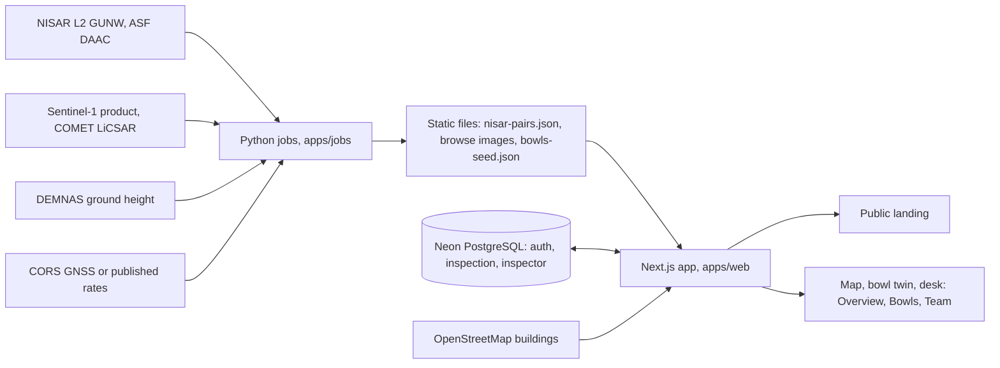

# PRD: Prioka — Jakarta subsidence and pumping leads from NISAR radar

Status: Draft. Updated 13 November 2026 to match the code on `main` (commit `3fe6cdc`) and the challenge page (last published 13 November 2026, 03:46 UTC). The repo name is `prioka`. The product name in the app is Prioka.

This PRD targets the NASA Space Apps Challenge 2026 challenge [Dancing with the SARs](https://www.spaceappschallenge.org/2026/challenges/dancing-with-the-sars/). The challenge levels are Intermediate and Advanced. The skill is Earth Science. The hackathon is on 14–15 November 2026. Judges score Impact, Creativity, Validity, Relevance, and Presentation. [Judging guide](https://spaceappschallenge.org/resources/judging-awards-guide)

## 0. Challenge fit

### What the challenge asks

The challenge asks teams to "build an interactive application that leverages radar remote sensing data from NISAR to track and visualize one or more types of surface changes, at locations around the world". It names "land surfaces deforming from earthquakes and coastal subsidence" as one type of change. The desired outcome is "an open-source, user-friendly solution that translates complex radar observations into actionable insights" for "scientists, resource managers, educators, decision-makers, and the public".

The challenge gives three steps:

1. Pick a study area. A hometown is a good choice.
2. Download free NISAR data from the resource list. Supplemental data (optical images, GIS layers) is permitted.
3. Present the findings in an interactive digital medium (report, video, slides, story map). "Hypothesize the physical drivers behind what you see (or don't see) in the SAR data." Say "what future applications of NISAR are possible".

Optional considerations: other polarizations or other frequencies from other sensors, a time series from different dates, ancillary data (for example population), human drivers such as industry, data storytelling, personal context for a hometown, and interactive parts such as image sliders and web maps.

### How Prioka answers each item

| Challenge item | Prioka answer | State on `main` |
| --- | --- | --- |
| Interactive application | Next.js web app: map, bowl page with a 3D digital twin, desk pages | Built |
| NISAR data | NISAR L2 GUNW browse images, track 10 ascending, 8 pairs from 26 June 2026 | Built (browse images only, not HDF5 values) |
| Surface change type | Coastal land subsidence in North Jakarta | Built with synthetic bowl values |
| Change over time | Year timeline 2015–2050, NISAR pass timeline, Sentinel-1 and NISAR chart | Built with synthetic series |
| Other frequency | Sentinel-1 (C-band) for the rate before the 2023 ban. SAOCOM (L-band, CONAE) is a possible second L-band check | Synthetic Sentinel-1 series. SAOCOM not started |
| Ancillary data | OpenStreetMap buildings, kecamatan names | Built |
| Human driver | Deep groundwater pumping and the 2023 groundwater ban | Built as the main story |
| Physical driver hypothesis | Section 4, "Physical driver hypothesis" | Written. Shown in the twin (soil layers, clay compaction, suspected well illustration) |
| Actionable insight | Ranked bowls become inspection leads with a visit workflow | Built |
| Open source | Public repo | Repo is ready to open |
| Hometown context | Team members live in Indonesia. Bandung test bowl exists (see Risks) | Partial |
| Story and presentation | Landing page, demo video, slides | Landing page built. Video and slides not started |
| Future NISAR applications | Section 5, v2.0 row | Written |

### Challenge resources (published 13 November 2026)

NASA does not endorse non-U.S. Government sites. Each site has its own data use terms.

| Resource | Provider | Use in Prioka |
| --- | --- | --- |
| [NASA Earthdata Search](https://search.earthdata.nasa.gov/search) | NASA | Find NISAR products. Earthdata login for HDF5 download |
| [ASF Data Search Vertex](https://search.asf.alaska.edu/) | ASF DAAC | NISAR GUNW search. `apps/jobs/fetch_nisar_browse.py` uses the ASF search API |
| [NISAR Data User Guide](https://nisar-docs.asf.alaska.edu/) | ASF | Product formats, availability, GUNW layers |
| [Intro to Remote Sensing](https://www.earthdata.nasa.gov/learn/earth-observation-data-basics/remote-sensing) | NASA Earthdata | Background for the landing page and FAQ |
| [Intro to SAR](https://www.earthdata.nasa.gov/learn/earth-observation-data-basics/sar) | NASA Earthdata | Wavelength and coherence text (F5) |
| [NASA ARSET Trainings](https://appliedsciences.nasa.gov/get-involved/training) | NASA Applied Sciences | InSAR and NISAR training for the method |
| [NISAR StoryMaps](https://nisar.jpl.nasa.gov/applications/arcgis-storymaps/) | NASA JPL | Includes a land subsidence story. Reference for the storytelling |
| [NISAR Applications White Papers](https://nisar.jpl.nasa.gov/applications/societal-benefit/) | NASA JPL | Cite the subsidence and groundwater application in the pitch |
| [UAVSAR Postcards](https://uavsar.jpl.nasa.gov/education/postcards.html) | NASA JPL | Not used |
| [RCM data](https://donnees-data.asc-csa.gc.ca/en/dataset/rcm), [SAR Python tutorial](https://github.com/asc-csa/Synthetic_Aperture_Radar_Tutorial), [RADARSAT-1 data](https://donnees-data.asc-csa.gc.ca/en/dataset/radarsat1) | CSA | Not used. RCM is C-band. Check Jakarta coverage only if Sentinel-1 fails |
| [SAOCOM catalogue](https://catalogos.conae.gov.ar/catalogo/catalogoSatSaocomInfo.html), [registration](https://www.argentina.gob.ar/noticias/la-informacion-saocom-cada-vez-mas-accesible) | CONAE | Optional L-band check. Needs registration. Not in the MVP |

Sentinel-1, DEMNAS, and Ina-CORS are not in the resource list. The challenge permits supplemental data.

The 29 October page said "Do not begin work on your projects until the hackathon begins." The 13 November page does not have this text. Open Decision 1 still asks the team to confirm the rule with the local lead.

## 1. Executive Summary

### Problem Statement

North Jakarta sinks by several centimeters each year, and some areas sink more than 10 cm a year. Deep groundwater pumping is the main cause. The ground above a heavy pump settles into a bowl. Jakarta banned groundwater use in large zones (Pergub 93/2021), but enforcement is weak, and piped water reaches only about 60% of the city. Regulators do not have a city-wide way to see where the ground still sinks, where the sinking points to pumping, and when the sea will reach a street.

### Proposed Solution

A web app for groundwater regulators. A public landing page explains the problem. After sign-in, a map flies from the globe to North Jakarta in 3D and shows each subsidence bowl as a stack colored by its rate. NISAR passes play over the map. A ranked bowl list leads to a bowl page: a 3D digital twin of the ground under the bowl, with soil layers, buildings, the high-tide level, and a year timeline that compares "with the ban" and "without the ban". A chart shows the Sentinel-1 rate before the 2023 ban and the NISAR motion in 2026. The desk (Overview, Bowls, Team) turns bowls into inspection leads: a regulator schedules a visit, assigns an inspector, and records the outcome.

### Confirmed scope

| Item | Decision |
| --- | --- |
| Main user | Groundwater regulators: Pemprov DKI (Dinas SDA) and PAM Jaya. They decide where to inspect and where to extend piped water. |
| Secondary user | National monitoring staff (BIG, Badan Geologi). National view planned (G1), not built. |
| Launch area | North Jakarta: 10 bowls in Penjaringan, Cilincing, Pademangan, and Tanjung Priok. |
| Data | Sentinel-1 for the long-term rate (before August 2023). NISAR for 2026 motion. On `main`, all bowl values and series are synthetic (`bowls-seed.json`, `"synthetic": true`). NISAR pass images are real browse images. |
| Internal format | A displacement time series per bowl: `series.sentinel1` and `series.nisar`, dates and mm. A velocity-only product enters as a rate with no history. |
| Processing | Batch Python jobs in `apps/jobs` write static files into `apps/web`. On-demand processing later. |
| Elevation | DEMNAS (BIG) planned. On `main`, each bowl has an example `groundHeightM`. |
| Hero view | Map: globe flight to North Jakarta, bowl stacks, 3D buildings. Bowl page: 3D digital twin. |
| Bowl ranking | Rank by sinking rate, bowl depth, and change after the ban. On `main`, rank and previous rank are seed values. No piped-water data in v1. |
| Inspection workflow | Status: lead, scheduled, inspected, closed (with outcome), dismissed. Outcome: pump found, no pump, natural compaction. Inspector, visit date, note. |
| Validation | CORS GNSS chart (F6). Not built. |
| Access | Landing, sign-in, sign-up, and design system pages are public. The map, bowl pages, and desk need a sign-in. The demo uses synthetic accounts from `bun run db:seed`. |
| Storage | PostgreSQL (Neon) through Drizzle: auth tables, `inspection`, `inspector`. Radar outputs stay in static files. |
| Language | Indonesian is the default locale. English is the second locale. |
| Map stack | MapLibre (mapcn) with 3D extrusions and a custom building layer. Three.js-style scene for the bowl twin. dithercn for charts. |
| Stack | Next.js 16 in `apps/web`, Python (uv) in `apps/jobs`, shared packages in `packages/`. |
| Deadline | The submission closes at the end of the hackathon on 15 November 2026. |
| Budget, team size | TBD. |

### Success Criteria

These targets are for the hackathon submission. They follow the judging criteria.

| # | KPI | Target | Judging criterion | How we measure |
| --- | --- | --- | --- | --- |
| 1 | Regulator task | At least 4 of 5 test users find the 3 highest-ranked bowls in Penjaringan and open the evidence for one of them in 3 minutes or less, without help. | Impact | Timed sessions. Start signed in on `/id/map` or `/en/map`. Record the time and any help. |
| 2 | User understanding | At least 4 of 5 test users can say why a bowl is a lead and not proof of a pump, and what the "below high tide" year assumes. | Impact, Validity | One question after the task. Two team members score the answer against the evidence panel. |
| 3 | Radar check | At every CORS station in the area, the radar rate and the station rate have the same sign, and the difference is inside the stated uncertainty. | Validity | The GNSS chart and a table of station rates. If CORS data is not available, compare with published rates and say so. |
| 4 | Evidence tracing | 100% of numbers in the map, charts, bowl list, bowl twin, and desk link to a source, period, scale, and method. | Validity | An audit of every panel, including 10 random bowls. |
| 5 | Challenge fit | Every row in section 0 "How Prioka answers each item" is Built, or the gap is stated in the demo. | Relevance | A checklist review of the demo path. |
| 6 | Real data | At least one number in the demo comes from a real NISAR HDF5 product, not a browse image or a seed value. | Validity | The evidence panel names the product file. |

Secondary targets:

- The split view shows an area where Sentinel-1 has low coherence and NISAR has a measurement, with numbers for both.
- The national view loads all three cities, and a user can compare their rates in 1 minute or less.

Out of scope for these targets: proof that a site pumps, measured flood dates, and legal enforcement results.

## 2. User Experience & Functionality

### User Personas

| User | Need | Decision the tool supports |
| --- | --- | --- |
| **Groundwater regulator** (main), Pemprov DKI and PAM Jaya | Enforce the groundwater-free zones. Reach full piped-water coverage. Use few inspectors well. | Which sites to inspect first, who visits, and which areas need piped water first. |
| **Inspector** (desk user) | Know which visits are theirs and when. | Visit order. Record what they found. |
| **National monitoring staff** (secondary), BIG and Badan Geologi | One view of subsidence in coastal cities. CORS stations are far apart. | Which cities and areas need closer monitoring or more stations. |
| **The public** (viewer) | Understand why the city sinks. | No decision. The landing page explains the problem. |

### User Flows

**Regulator:**

1. Open the landing page. Sign in.
2. Open Overview: active bowls, fastest rate, bowls that did not slow after the ban, leads that had a pump, the latest and next NISAR pass, and what changed since the last pass.
3. Open the map. It flies from the globe to North Jakarta in 3D. Bowls show as stacks colored by rate.
4. Turn on "Radar passes" to step through the NISAR pairs.
5. Open the ranked list. Select a bowl. The bowl page opens.
6. On the bowl page, pick a year and switch "with ban" and "without ban". Read the depth, the year the floor goes below high tide, and the chart.
7. Open the evidence for any number.
8. Schedule a visit, assign an inspector, and later record the outcome.
9. Share the URL of the bowl page.

**National staff:** Not built. Planned flow: open the national view, see Jakarta, Semarang, and Pekalongan velocity layers, select a city, see its rate range, its CORS stations, and its data dates.

### User Stories and Acceptance Criteria

Each feature has a state: Built, Partial, or Not built.

#### F1. See the sinking city — Built

**Story:** As a regulator, I want to see North Jakarta sink in 3D so that I can understand the size of the problem in one view.

**Acceptance criteria:**

- The map opens on a globe and flies to North Jakarta. With reduced motion, it goes to North Jakarta with no flight.
- Each bowl is a stack of three round tiers. Height and width grow with the rate. Color follows the rate. Buildings show in 3D.
- The legend states the rate in mm/yr. A taller stack means a deeper drop by the baseline year.
- The map shows every bowl at a fixed baseline (2035, ban on). The year and the ban switch live on the bowl page.
- A 2D view is available with the same numbers.

#### F2. Watch NISAR passes over time — Built

**Story:** As a regulator, I want to step through each NISAR pass so that I can see that the data is fresh and real.

**Acceptance criteria:**

- The map shows each NISAR pair from the catalog as an image on the map. A bar timeline (one bar per pass) and a play button step through the pairs.
- Each pair shows its two dates and the days between them. The bar height is the share of clean signal.
- A text states that one color cycle is about 12 cm of line-of-sight motion and that, in a 12-day pair, most color is water vapor.
- Playback is off with reduced motion.

Gap: the clean-signal share comes from a roughness rule on the browse image (`ROUGHNESS_LIMIT` in `fetch_nisar_browse.py`), not from HDF5 coherence. Only track 10 ascending is loaded.

#### F3. Find likely pumping bowls — Partial

**Story:** As a regulator, I want a ranked list of subsidence bowls so that I can choose where to inspect first.

**Acceptance criteria:**

- The bowl detector finds areas that sink faster than their surroundings and have a bowl shape. **Not built. Bowls are seed values.**
- Each bowl has a center, a radius, a peak rate, a depth, a rank, and a previous rank. **Built.**
- The rank uses sinking rate, bowl depth, and the change in rate after the ban. The rank method is visible. **Not built.**
- Each bowl uses the label "lead for inspection, not proof of a pump". The suspected well in the twin is labeled "Illustration, not measured". **Built.**
- The tool shows no owner names and makes no claim about a building or a person.
- The list works with a keyboard and a screen reader, and it does not need the map. **Built** (map list and the Bowls desk table).

#### F4. See one bowl over time — Built

**Story:** As a regulator, I want to see whether a bowl still sinks after the ban so that I can judge whether enforcement works there.

**Acceptance criteria:**

- The bowl page has a 3D digital twin with four views: overview, cut-away, street, and plan.
- Layer toggles: buildings, scenery, contours, ban grid, rate color, high tide, and labels.
- A year bar timeline runs from measured years (from 2015) to 2050. Each bar shows the depth with and without the ban. NISAR years are marked.
- Pickable parts (bowl center, bowl edge, buildings, NISAR passes, soft clay, suspected well, high-tide level, ground block) open a card with numbers.
- The page shows the year the bowl floor goes below high tide, with and without the ban.
- The chart shows Sentinel-1 displacement before the ban and NISAR displacement from June 2026, with a ban line. The two sources are not joined into one line, and the chart says why.
- The rate before and after the ban shows with uncertainty.
- Heights are exaggerated, and the page states the factor.

#### F5. Compare L-band and C-band — Not built

**Story:** As national staff, I want to compare NISAR and Sentinel-1 coverage so that I can see where L-band adds measurements.

**Acceptance criteria:**

- A split-view slider shows Sentinel-1 coherence on one side and NISAR coherence on the other.
- The panel gives the share of area with usable coherence for each sensor, for the same area and a similar time span.
- The text explains in plain words why the longer wavelength keeps signal over trees, ponds, and open land.
- The slider works with a keyboard.

This is the challenge's "image slider" and "different frequencies" idea.

#### F6. Check the radar against the ground — Not built

**Story:** As national staff, I want to compare the radar with CORS stations so that I can decide how much to trust the map.

**Acceptance criteria:**

- The chart shows the CORS height time series and the radar displacement at the pixel over the station, on one time axis.
- The chart shows each rate and its uncertainty.
- If CORS data is not available, the chart shows the published station rate with its paper and period, and labels it "published rate".
- Line-of-sight motion is converted to vertical motion with a stated method before the comparison.

#### F7. See why — Partial

**Story:** As a regulator, I want to see the evidence behind each number so that I can defend an inspection decision.

**Acceptance criteria:**

- Each number opens a short text with the source, product, dates, scale, and method. **Built for depth, rate, and projection.**
- The evidence states "This prototype shows example values. They are not measurements." while values are synthetic. **Built.**
- Satellite measurements, model estimates, projections, illustrations, and example values have different labels. **Built.**
- Old, missing, and low-coherence data have different states. **Not built.**
- The Overview "AI Insight" card is a fixed sentence filled from bowl data. No model makes it. **Gap:** rename the card or add a note, because section 3 says the MVP uses no language model.

#### F8. Share a view — Built

**Story:** As a regulator, I want to share a link to a bowl so that I can discuss it with my team.

**Acceptance criteria:**

- The URL holds the selected bowl, the year, the ban setting, the view, and the map position.
- Opening the link shows the same view after sign-in.
- The shared view keeps the label "lead for inspection, not proof of a pump".

#### F9. Manage inspections — Built

**Story:** As a regulator, I want to turn a bowl into a visit so that the team acts on the leads.

**Acceptance criteria:**

- The Bowls desk page is a table with search and filters (kecamatan, status, inspector, visit date) and counts for leads, scheduled visits, overdue visits, and the fastest rate.
- From the table or the bowl page, a regulator can schedule a visit (inspector and date), record an outcome with a note, dismiss a bowl, or restore it as a lead.
- A bowl with no inspection record is a lead.
- Overdue visits are marked.
- Each change stores the user and the time.

#### F10. Manage the team — Built

**Story:** As a regulator, I want a roster of inspectors and their load so that I can share visits fairly.

**Acceptance criteria:**

- The Team page lists inspectors with open visits and the next visit.
- A regulator can add, edit, archive, and restore an inspector.
- The page shows active inspectors, visits this week, overdue visits, and the heaviest load.

#### F11. Overview — Built

**Story:** As a regulator, I want one page that tells me what changed since the last NISAR pass.

**Acceptance criteria:**

- The page shows active bowls, the fastest rate, the bowls that did not slow after the ban, and the share of inspected leads that had a pump.
- The page shows the latest NISAR pass, the next expected pass, and a late state when the next pass is not in the catalog.
- The page lists changes since the last pass: rank up, rank down, new bowl, and slowing.
- Charts: bowls by kecamatan, case status, effect of the ban, and mean ground movement.

#### G1. See the national view — Not built

**Story:** As national staff, I want to see the rates in Jakarta, Semarang, and Pekalongan so that I can compare the cities.

**Acceptance criteria:**

- The map shows a velocity layer for each city, with one legend.
- Each city shows its rate range, the data source, and the dates.
- Cities with only Sentinel-1 data are marked. NISAR coverage is shown where it exists.
- Only North Jakarta has bowls and the twin in v1. Other cities say "detail not available".

### Experience Requirements

- Desktop first for regulators. The landing page, the map, and the bowl page must work on a phone that is 360 px wide.
- Indonesian is the default. English is the second language. Every string is in `en.ts` and `id.ts`.
- Meaning must not depend only on color. Rates show a number, and the legend has text.
- The user can do the core tasks with a keyboard or a screen reader. The bowl list works without the map.
- Follow `design.md` and the design rules in `CLAUDE.md`.

### Non-Goals

- Naming people, companies, or buildings as pumpers. A bowl is a lead for inspection.
- Piped-water service data in the bowl rank in v1.
- A flood forecast, an emergency warning, or a legal flood map.
- Sea-wall design levels.
- Self-service accounts. Accounts are seeded. Stored data is limited to accounts, inspections, and inspectors.
- Our own time-series inversion of raw Sentinel-1 data. We use a published Sentinel-1 product.
- On-demand processing of new areas in the MVP.
- A chat assistant or other generative AI features.
- A WhatsApp bot. It is a later idea.

## 3. AI System Requirements

The MVP uses no language model and trains no model. Fixed, tested processing steps calculate rates, find bowls, rank them, and project dates. This keeps every number traceable. The "Insight" texts on Overview and the bowl page are fixed templates filled with computed numbers.

### Tool Requirements

- **NISAR browse job (built).** `apps/jobs/fetch_nisar_browse.py` searches ASF for GUNW products over Jakarta, keeps track 10, downloads the browse PNGs, fits their corners to the product footprint, scores the clean-signal share, and writes `public/nisar/*.webp` and `nisar-pairs.json`.
- **Ingestion adapters (not built).** One adapter for each source product. Each adapter checks units, dates, grid, and reference, and writes the internal format. It rejects a file with missing metadata and logs the reason.
- **NISAR time series (not built).** Chain the 12-day GUNW pairs into a series for each track. Mask low-coherence pixels. Handle a gap in the chain without a false jump.
- **Vertical motion (not built).** Combine ascending track 10 and descending track 18. If only one track is available, assume vertical motion and say so.
- **Bowl detector (not built).** Find local minimums in the vertical rate surface that are faster than their surroundings by a set amount and have a near-round shape. Record center, radius, peak rate, and depth.
- **Below-high-tide projection (built on seed values).** Ground height minus rate × years, compared with the high-tide level. Use the same vertical datum for both.
- Jobs write static files that the web app reads. The app never downloads NISAR files during a page request.

### Evaluation Strategy

- **Rule tests:** At least 15 fixed cases for the adapters, the time-series chain, the bowl detector, and the projection. On `main`: 4 tests, for the visit and inspector logic only.
- **Ground check:** Compare the radar rate with each CORS station in the area (KPI 3). If no CORS data, use published rates and report this.
- **Known-case check:** Muara Baru has published rates, from about 20–26 cm/yr in the past to about 10–12 cm/yr. Our rates must be in the same range, or the PRD records the difference. (The seed uses 112 mm/yr before and 92 mm/yr after the ban.)
- **Sensor check:** Where Sentinel-1 and NISAR both have good coherence, their vertical rates for the same period type must agree within the stated uncertainty.
- **Atmosphere check:** Show that the 2026 NISAR rate is not explained by water vapor alone, for example by comparing ascending and descending results or by using a stack of pairs.
- **Bowl check:** Compare bowl centers with any public deep-well or permit data. A match is support, not proof.
- **Accessibility and motion checks:** Reduced motion, keyboard use, and the 2D view still permit the regulator task.

## 4. Technical Specifications

### Architecture Overview

Built on `main`: the NISAR browse path, the static seed, the database, and the web app. Not built: Sentinel-1, DEMNAS, and CORS inputs, and the bowl detector.

- **Batch jobs** are idempotent: running a job again on the same input gives the same output and no duplicates.
- **The web app** reads radar outputs from static files. The database holds only accounts, inspection status, and inspectors.
- **Line-of-sight to vertical:** use both tracks where both cover a pixel. Keep the method and the incidence angles with the result.
- **Reference point:** choose a stable reference area for each track and store it. All rates are relative to that area.
- **Projection limits:** the projection assumes a constant rate. It has no sea wall, no pumping change, and no sea-level rise. A year is "at current rates", not a forecast.
- **Evidence records** include product, version, track, dates, units, grid, reference point, coherence threshold, and method for each output.

### Integration Points

| Source | Use | State |
| --- | --- | --- |
| NISAR L2 GUNW (provisional) | 2026 displacement, coherence, pass timeline | Browse images for 8 pairs on track 10 ascending (frame 174), from 26 June 2026, in 12-day steps. Descending track 18 (frames 91, 92) is in the ASF catalog but not loaded. Full HDF5 (about 2.3 GB each) needs an Earthdata login. [ASF availability](https://nisar-docs.asf.alaska.edu/availability-overview/) |
| NISAR GCOV | Optional: backscatter and polarization context, such as water and fish ponds | Not used. The challenge suggests polarizations as an option. |
| Sentinel-1 (COMET LiCSAR / LiCSBAS) | Long-term rate 2015–2023, the C-band side of the split view | Synthetic series in the seed. Check frame coverage and license. |
| SAOCOM (CONAE) | Optional second L-band source | Not used. Needs registration. |
| DEMNAS (BIG) | Ground height for the projection | Example heights in the seed. Check the datum and its age. |
| High-tide level | Sea level in the twin | Example value 0.9 m in the seed, labeled as an example. Source TBD: Tanjung Priok tide gauge or a published value. |
| Ina-CORS (BIG) | Ground check | Not used. Access may need registration. Fallback: published station rates. |
| OpenStreetMap | Basemap and building footprints on the map and in the twin | Built. |
| Administrative boundaries | Kecamatan names | Names are in the seed. BIG boundaries not loaded. |

**Jakarta context.** Groundwater use is restricted by Pergub 93/2021, with stronger limits from August 2023. Piped water covers about 60% of the capital. BIG names three monitoring gaps: few CORS stations (473 in Indonesia), mixed subsidence and sea-level signals at the coast, and poor InSAR over vegetation. L-band addresses the third gap. [BIG, UN-GGIM 2024](https://www.un.org/globalgeospatial/sites/default/files/2026-04/4_bayu_sea_level_rise_and_land_subsidence_monitoring_in_indonesia_2-12-24.pdf) · [Jakarta Post](https://www.thejakartapost.com/opinion/2023/11/18/protecting-groundwater.html) · [SCMP](https://scmp.com/news/asia/southeast-asia/article/3241393/indonesia-aims-stop-jakarta-sinking-further-curbing-groundwater-use)

**Data warning.** BIG slides give two different Jakarta CORS rates: 6.4 cm/yr and 0.33 cm/yr (2015–2019). One station is not the city. Always show the station, the period, and the source.

**Physical driver hypothesis (for the challenge).** Deep groundwater pumping lowers the water pressure in the sandy aquifer. The soft clay above loses water and compacts, and the ground settles into a bowl around the pump. The twin shows this with soil layers (fill, soft clay, sand, stiff clay, deep sand with water) and an illustrated well. Where the ban works, the rate after August 2023 should fall. Other drivers to state: building load on young sediments, and natural compaction (one of the three inspection outcomes). What we may not see: NISAR has only about 3–4 months over Jakarta, so a slow rate change can hide under water-vapor noise. A bowl that does not slow after the ban can point to pumping that continues, or to compaction that lags the pressure change by years.

### Security & Privacy

- The landing page is public. The map, bowl pages, and desk need a sign-in. The demo uses synthetic accounts from `bun run db:seed`.
- The app stores accounts, inspection status, and inspectors. Inspector names in the demo must be synthetic.
- The app does not name owners, companies, or people. Bowls are areas, not addresses of a person.
- Keep Earthdata and other credentials in job secrets or `~/.netrc` on the machine that runs the jobs. Never put them in the repo or send them to the browser.
- Show source attribution and licenses for NASA, JPL, ISRO, ASF, ESA/Copernicus, COMET, BIG, and OpenStreetMap. The landing page has NASA/JPL/ISRO/ASF and OpenStreetMap today.
- The code is open source, as the challenge asks.

## 5. Risks & Roadmap

### Phased Rollout

| Phase | Date | Scope | Exit criteria |
| --- | --- | --- | --- |
| Prototype | Up to 13 Nov 2026 | F1, F2, F4, F8–F11 on synthetic values and real NISAR browse images. | Done on `main`. |
| Hackathon | 14–15 Nov 2026 | Replace seed values with real data where possible (KPI 6): NISAR HDF5 for at least one bowl, a published Sentinel-1 rate, published CORS rates. F7 states. Fix the gaps in section 0. Demo video, slides, and project page. | Rule tests pass. Each KPI is met, or the gap is reported in the demo. Submission complete. |
| v1.1 | Dec 2026 – Jan 2027 | Bowl detector and rank method (F3). Split view (F5). GNSS chart (F6). Descending track and vertical motion. Piped-water coverage in the rank. | Test with regulator staff. KPI 3 holds with more data. |
| v2.0 | 2027 | National view (G1) with Semarang and Pekalongan. On-demand processing for any area. Public bowl catalog. A bot that answers "when does my street go under the sea?" | A partner agency uses the bowl list in a pilot. |

**Future NISAR applications (for the challenge).** NISAR's 12-day repeat and free L-band data let a city check every pass whether enforcement slows the ground. The same pipeline can watch other pumping cities (Semarang, Pekalongan, Mexico City, the Central Valley), dyke and sea-wall settlement, and fish-pond and wetland change from GCOV polarizations.

### Technical and Product Risks

| Risk | Effect | Response |
| --- | --- | --- |
| All bowl values are synthetic on `main` | Judges score Validity low. | KPI 6. The evidence panel says "example values" until real data replaces them. Say it in the demo. |
| Space Apps rules on work before the event | The prototype may not count. | Confirm with the local lead (Open Decision 1). |
| About 108 days of NISAR is short | At 5–10 cm/yr the ground moves only 1.5–3 cm, close to the atmosphere noise. | Use Sentinel-1 for the long-term rate. Use NISAR for "still sinking or not", with uncertainty. Use both tracks and a stack, not one pair. |
| Water vapor in a single pair looks like motion | Users read noise as sinking. | Do not show a single pair as a rate. The pass legend says so. |
| No Earthdata access in time | Only browse images are available. | Set up access on the first hackathon day. Fallback: browse images and published rates, and say so. |
| Clean-signal share comes from a browse-image rule | The bar heights are not real coherence. | Replace with HDF5 coherence. Until then, label it in the evidence. |
| The bowl detector finds no clean bowls | The list is empty. | Test on Sentinel-1 first. Show the rate map and say "no clear bowls". |
| A bowl is read as an accusation | Harm to a person or business. | No names. "Lead for inspection" label. The well is an illustration. |
| Seed bowl "Doksli Rumah Zaki" (Sukasari, Bandung) | A bowl named after a person's house, outside North Jakarta. It breaks the no-names rule and the launch area. | Remove it or rename it to a synthetic area name before the demo. |
| "AI Insight" label | Judges or users think a model makes the text, against section 3. | Rename the card, or state that the text is a template. |
| Landing says "See the public map", but the map needs a sign-in | Judges cannot open the map. | Give judges a demo account, or make the map public again. Decide before submission (Open Decision 10). |
| DEMNAS height is old or has a different datum | Wrong "below high tide" years. | Record the datum and date. Show the year as a range. Label it a projection. |
| CORS data needs registration | No ground check. | Use published rates and report the fallback. |
| Line-of-sight is mistaken for vertical motion | Wrong rates. | Combine both tracks. State the method. |
| Scope exceeds the event time | No working demo. | `main` already works end to end. Add real data one source at a time and keep the working version at each step. |

### Open Decisions

1. Confirm the Space Apps rules on the prototype built before 14 November.
2. Confirm the method: time-series chaining, atmosphere handling, reference point, and the vertical conversion.
3. Confirm the evaluation plan: which CORS stations, which published rates, and which tolerance counts as agreement.
4. Choose the Sentinel-1 product and check its coverage and license.
5. Choose the high-tide source and the vertical datum for DEMNAS.
6. Set the bowl detector thresholds and the rank weights.
7. Decide the demo language. The app default is Indonesian. The NASA judges may need English.
8. Set the team size, the test users, and the device targets.
9. Decide whether GCOV polarizations or SAOCOM add enough to include them.
10. Decide how judges reach the signed-in map: a shared demo account or a public map.
11. Decide the product name for the submission: Prioka (app) or Prioka (repo).
