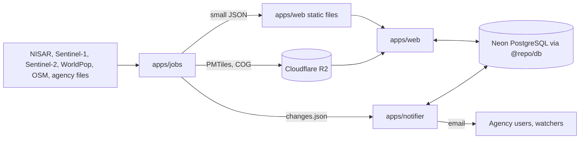

# Services in `apps/`

Status: Draft. Date: 15 November 2026. Source documents: [HLD](hld-orbitalis.md), [PRD](prd-orbitalis.md), [Business Flow](business-flow.md), [Feature map](feature-map.html).

This document lists the services that live in `apps/`, what each one owns, and when each one is needed. The rule from `CLAUDE.md` applies: everything stays in this monorepo, and a new unit goes under `apps/` or `packages/`.

## Summary

The product needs **three services**. Two exist. One is added in Phase 2.

| Service         | Language               | Runs                                        | Owns                                                                 | State              |
| --------------- | ---------------------- | ------------------------------------------- | -------------------------------------------------------------------- | ------------------ |
| `apps/web`      | TypeScript, Next.js 16 | Cloudflare Workers (OpenNext), all the time | Every page, every user action, the database writes                   | Exists             |
| `apps/jobs`     | Python 3.11, uv        | Batch, after each NISAR pass and each month | Every number that comes from satellites, population, or agency files | Exists (3 scripts) |
| `apps/notifier` | TypeScript, Bun        | Batch, after `apps/jobs` publishes a pass   | The pass digest email and area watch messages (F20)                  | New in Phase 2     |

Shared code stays in `packages/`: `@repo/db` (schema and client), `@repo/auth`, `@repo/env`, `@repo/ui`, `@repo/config`. `apps/web` and `apps/notifier` both use `@repo/db`.

## `apps/web`

**Purpose.** The only service people use. It shows the map, the bowl page, the desks, and the public pages. It stores what people create or decide.

**Owns.**

| Area        | Pages and parts                                                                                                  | Needs  |
| ----------- | ---------------------------------------------------------------------------------------------------------------- | ------ |
| Public      | Landing (exists), area check `/check` (new, with the water farming calculator)                                   | N6     |
| Map         | Five layers in the "Show" picker, priority filter, ranked list, area panel, parcel drawing and site report print | N1–N5  |
| Bowl page   | 3D twin (exists), groundwater use estimate panel, case report print                                              | N1     |
| Desks       | Overview (role changes), Bowls (leads and water farming site visits), Team                                       | N1, N4 |
| Data writes | Server actions for inspections and inspectors (exist), water farming sites, plan items, area watches             | All    |
| Access      | Sign-in (exists), roles per agency (new, F18)                                                                    | All    |

**Reads.** Static JSON in the app (`bowls-seed.json`, `nisar-pairs.json`, later the job outputs), raster tiles from R2 in the browser, and the database.

**Never does.** Download satellite files, run processing, or send bulk email during a request. The Worker has size limits (commit `6f78a99`), so large data stays in R2.

**Feature folders to add** (under `src/features/`, following `.agents/skills/nextjs-app-architecture`):

| Folder           | Holds                                                                                            |
| ---------------- | ------------------------------------------------------------------------------------------------ |
| `map` (exists)   | Layer picker options, priority filter, generic ranked list, area panel, parcel drawing           |
| `areas` (exists) | Priority areas: the area seed, its query, and the score and filter rules (`areas-priority.ts`)   |
| `projection`     | Groundwater use estimate panel, shared by the bowl page, area panel, site report, and area check |
| `water-farming`  | Site layer, site panel, calculator, site actions                                                 |
| `area-check`     | The public `/check` page parts                                                                   |
| `bowls` (exists) | Case report print view, type filter for sites                                                    |

## `apps/jobs`

**Purpose.** Turn raw data into the files the web app reads. Every job is a Python script, idempotent, and writes an evidence record next to its output (source, product, version, dates, method, units, threshold).

**Owns.** All processing steps in HLD section 3.1. The scripts stay flat, one script per step, as the scripts today.

| Script                    | Step              | Input                                                                                                                   | Output                                                                                                                                                        | Phase | State  |
| ------------------------- | ----------------- | ----------------------------------------------------------------------------------------------------------------------- | ------------------------------------------------------------------------------------------------------------------------------------------------------------- | ----- | ------ |
| `fetch_nisar_browse.py`   | Pass images       | ASF search API                                                                                                          | `public/nisar/*.webp`, `nisar-pairs.json`                                                                                                                     | 0     | Exists |
| `seed_areas.py`           | Synthetic areas   | `bowls-seed.json`                                                                                                       | `areas-seed.json`: 500 m cells with sinking rate, population, piped share, and economic activity, all `synthetic`. Replaced by the Phase 2 scripts            | 0     | Exists |
| `detect_bowls.py`         | Bowl detector     | One GUNW HDF5 pair now. Later a vertical velocity grid: the NISAR stack, or Sentinel-1 PS points after `grid_points.py` | Bowls with center, radius, peak rate, noise floor                                                                                                             | 0, 1  | Exists |
| `fetch_nisar_gunw.py`     | Ingest            | ASF search, Earthdata Login token in `NASA_API_KEY`                                                                     | The mainland Jakarta window and LOS vector of each GUNW pair on track 10 or track 18 frame 92 (`--track`), read with HTTP range requests, in `out/gunw-jakarta/<track>/` | 0     | Exists |
| `stack_nisar_rate.py`     | Stack rate        | `out/gunw-jakarta/10/`, `out/gunw-jakarta/18/`, `bowls-seed.json`, Nominatim reverse geocoding                          | `nisar-rates.json`: vertical and east rates and a vertical series per bowl relative to the ground within about 3 km, and lead candidates named by kelurahan. A stack, not MintPy | 0     | Exists |
| `nisar_timeseries.py`     | Time series       | GUNW stack                                                                                                              | Displacement series, velocity, temporal coherence (MintPy)                                                                                                    | 1     | New    |
| `sentinel1_rate.py`       | Long-term rate    | Path A: Sentinel-1 SLC stack, ascending and descending, aligned with ISCE2 `topsStack`. Path B: LiCSAR interferograms   | Path A: PS points with velocity, time series, amplitude stability, temporal coherence (MiaplPy with MintPy). Path B: velocity grid (LiCSBAS). 2015–2023       | 1     | New    |
| `grid_points.py`          | Points to grid    | PS points from `sentinel1_rate.py` (Path A only)                                                                        | Velocity grid on the radar grid (EPSG:32748): median of the points per cell, point count, spread. Cells with too few points stay empty                        | 1     | New    |
| `vertical_motion.py`      | Vertical motion   | Ascending and descending velocity grids from `nisar_timeseries.py`                                                      | Vertical and east-west velocity on the MintPy output. The stack version lives in `stack_nisar_rate.py` today                                                  | 1     | New    |
| `validate_rates.py`       | Rate check        | Vertical and line-of-sight velocity, CORS station rates, published rates                                                | A table per pass: our rate vs each CORS station and vs Handika et al. 2024, with the difference and the tolerance. Pass or fail for the quality gate          | 1     | New    |
| `population.py`           | Population        | WorldPop, BPS totals, PAM Jaya coverage                                                                                 | People and people without pipes per cell                                                                                                                      | 2     | New    |
| `economic_activity.py`    | Economic activity | OSM land use and building types, VIIRS night lights, BPS Sensus Ekonomi                                                 | Low, medium, high per cell                                                                                                                                    | 2     | New    |
| `groundwater_balance.py`  | Projection        | Vertical velocity, population, permits                                                                                  | Estimates A and B, ratio, scenarios to 2050                                                                                                                   | 2     | New    |
| `priority_scores.py`      | Scores            | All of the above                                                                                                        | Pumping lead, recharge, pipe, and water farming scores with the three filter factors                                                                          | 2     | New    |
| `optical_check.py`        | Water farming     | Sentinel-2, site polygons                                                                                               | Open water and green cover per site, each month                                                                                                               | 3     | New    |
| `water_farming_impact.py` | Water farming     | Vertical series, adoption per area                                                                                      | Rate change in high-adoption areas vs control areas                                                                                                           | 3     | New    |
| `export_layers.py`        | Publish           | All outputs                                                                                                             | Small JSON into `apps/web`, PMTiles and COG to R2, `changes.json` for the notifier                                                                            | 1     | New    |
| `run_pass.py`             | Chain             | A new NISAR pass                                                                                                        | Runs the scripts above in order and stops at the quality gate. `validate_rates.py` is part of the gate                                                        | 1     | New    |

### Method from the BRIN paper

Handika, Widodo, and Pravitasari (2024) measured Jakarta with PS-InSAR on Sentinel-1. The paper does not detect bowls. Bowl detection is our own step (`detect_bowls.py`). The jobs use the paper in three places:

| From the paper                                                                                          | Script               | How                                                          |
| ------------------------------------------------------------------------------------------------------- | -------------------- | ------------------------------------------------------------ |
| PS-InSAR with at least 20 images, amplitude stability index 0.8 or more, temporal coherence 0.9 or more | `sentinel1_rate.py`  | Path A uses the same limits                                  |
| Mean rate −5.71 cm/yr for 2021–2022, fastest in North and West Jakarta                                  | `validate_rates.py`  | Known-case check                                             |
| MICMAC driver ranking                                                                                   | `priority_scores.py` | Fixed weights. Expert input used once, so no script makes it |

Three differences from the paper, and how the jobs handle them:

1. **Software.** The paper used SARPROZ, which is licensed. The jobs use open tools.
   - **Path A (recommended when compute allows):** ISCE2 `topsStack` aligns the Sentinel-1 SLC images, then MiaplPy finds PS and distributed scatterer pixels, then MintPy makes the time series. This keeps the paper's PS limits. It needs the full SLC stack (each image is a few GB) and many hours on a large machine.
   - **Path B (fallback):** LiCSBAS on LiCSAR interferograms from COMET. Much cheaper, because COMET already made the interferograms. It is a small-baseline method on a grid, so the paper's PS limits do not apply. The evidence record says which path made the rate.
2. **Points, not a grid.** PS gives separate points (161,206 points over Jakarta in the paper). `detect_bowls.py` needs a grid, so `grid_points.py` runs between them on Path A. A cell with too few points stays empty, and the evidence shows the point count per cell.
3. **One geometry.** The paper used ascending passes only, so its rates are line-of-sight. `validate_rates.py` compares our ascending line-of-sight rate with the paper, for the same period (2021–2022), before it compares vertical rates with CORS.

**Runs.** On a workstation now. On a scheduled runner when passes are processed every 12 days (a GitHub Actions workflow or a small VM, Open Decision 1 below). MintPy and HDF5 files need more memory and time than a CI job usually gives, so the runner choice depends on a test run.

**Secrets.** Earthdata login in `~/.netrc` or runner secrets. R2 keys in runner secrets. Never in the repo.

**Contract with `apps/web`.** Each JSON file has a `synthetic` flag and an `evidence` block. `apps/web` checks the shape when it reads a file and fails the build if a field is missing.

**Gap.** The units in `packages/` have no `AGENTS.md` and `CLAUDE.md`. `CLAUDE.md` at the root asks for both in every unit. Add them with the next change to each unit.

## `apps/notifier`

**Purpose.** Send one email per user after each NISAR pass with the changes for their role, and send area watch messages (F20).

**Why a separate service.** It needs the users, roles, and watches from the database, so it uses `@repo/db` in TypeScript. `apps/jobs` is Python and does not touch the database. `apps/web` runs on request in a Worker and must not send bulk email. A small Bun script keeps each service to one job.

**Owns.**

| Input                                                                            | Output                                               |
| -------------------------------------------------------------------------------- | ---------------------------------------------------- |
| `changes.json` from `export_layers.py` (the same change list the Overview reads) | One digest email per user with the digest on         |
| `area_watch` rows                                                                | A message when a watched area changes its rate class |
| Quality gate result                                                              | One line "no update this pass" with the reason       |

**Runs.** Right after `run_pass.py` succeeds, on the same runner. It does nothing when `changes.json` has not changed (idempotent by pass id).

**Needs.** An email delivery service (Open Decision 14 in the PRD). A `.env` with the database URL and the email key. `AGENTS.md` and `CLAUDE.md` from the start.

**When.** Phase 2, together with roles (F18). Until then, the Overview shows the same changes in the app.

## What is not a separate service

| Idea                     | Decision | Why                                                                        |
| ------------------------ | -------- | -------------------------------------------------------------------------- |
| Tile server              | No       | MapLibre reads PMTiles from R2 with range requests                         |
| Separate API server      | No       | Next.js server actions and route handlers cover all writes and reads       |
| Machine learning service | No       | All scores are fixed formulas (PRD section 3)                              |
| Queue or message broker  | No       | One pass every 12 days. `run_pass.py` runs the steps in order              |
| Separate admin app       | No       | Admin tasks (roles, inspectors) are pages in `apps/web` behind a role      |
| Report or PDF service    | No       | Case report and site report print from the browser with a print stylesheet |

Add a service only when one of these reasons stops being true.

## Open decisions

1. Where `apps/jobs` runs on a schedule: GitHub Actions or a small VM. Decide after one full MintPy run on the Jakarta stack.
2. Email delivery service for `apps/notifier`.
3. Sentinel-1 path: A (ISCE2, MiaplPy, MintPy, same method as the BRIN paper) or B (LiCSBAS on LiCSAR, cheaper). Decide after a test run on one Jakarta frame.
4. Tolerance that counts as agreement in `validate_rates.py`, for CORS stations and for the BRIN mean rate.
5. Whether `export_layers.py` writes job JSON into `apps/web` (deploy needed per pass) or to R2 only (no deploy, the app reads at request time with caching).
